# OOMD Diagram 2: Class Diagram

**Project:** Digital Quiz Portal (Online Exam & Assessment Portal)  
**Academic Subject:** Object-Oriented Modeling and Design (OOMD)  
**Authoritative Source:** OOMD Project Report (`docs/OOMD_Report.pdf`, Page 1, Diagram 2)  
**Implementation Source:** Domain Services (`src/services/`), DAL (`src/dal/`), Database (`src/database/`)  
**Status:** **VERIFIED & RECONCILED WITH IMPLEMENTATION**

---

## 1. Diagram Purpose

The Class Diagram documents the static structural architecture of the Digital Quiz Portal. It models:
1. The domain entities representing business objects and relational records (`User`, `Quiz`, `Question`, `Submission`, `SubmissionAnswer`).
2. The core business logic domain services (`AuthService`, `QuizManagementService`, `ExamService`, `ScoringService`, `AnalyticsService`).
3. The Data Access Layer (DAL) repositories (`UserRepository`, `QuizRepository`, `SubmissionRepository`) and WebAssembly SQLite database engine wrapper (`DatabaseClient`).
4. The structural relationships: Object-oriented specialization (inheritance), composition of child records, entity associations, and service-to-repository dependencies.

---

## 2. Mermaid UML Diagram

```mermaid
classDiagram
    %% Base Domain Entities
    class User {
        +int id
        +string username
        +string role
        +string password_hash
        +string salt
        +string created_at
    }

    class Admin {
        +manageQuizzes()
        +viewAnalytics()
    }

    class Student {
        +takeExam()
        +viewHistory()
    }

    User <|-- Admin : Specialization (role = 'admin')
    User <|-- Student : Specialization (role = 'student')

    class Quiz {
        +int id
        +string title
        +int duration_minutes
        +int is_published
        +int created_by
        +string created_at
    }

    class Question {
        +int id
        +int quiz_id
        +string question_text
        +string option_a
        +string option_b
        +string option_c
        +string option_d
        +int correct_option
        +int order_num
    }

    class Submission {
        +int id
        +int user_id
        +int quiz_id
        +int total_questions
        +int score
        +float percentage
        +string status
        +int is_timed_out
        +string started_at
        +string expires_at
        +string submitted_at
    }

    class SubmissionAnswer {
        +int id
        +int submission_id
        +int question_id
        +int selected_option
        +int is_correct
    }

    %% Entity Relationships
    User "1" --> "0..*" Quiz : authors
    User "1" --> "0..*" Submission : attempts
    Quiz "1" *-- "1..*" Question : contains (Composition)
    Quiz "1" --> "0..*" Submission : evaluates (Association)
    Submission "1" *-- "1..*" SubmissionAnswer : records (Composition)
    Question "1" <-- "0..*" SubmissionAnswer : references (Association)

    %% Business Domain Services
    class AuthService {
        -UserRepository userRepo
        -Map sessions
        +login(username, password)
        +validateSession(token)
        +logout(token)
        +getUserRole(token)
        +hashPassword(password)
        +verifyPassword(password, hash, salt)
    }

    class QuizManagementService {
        -QuizRepository quizRepo
        -SubmissionRepository submissionRepo
        -DatabaseClient db
        +createQuiz(params)
        +getQuizById(quizId)
        +publishQuiz(quizId)
        +unpublishQuiz(quizId)
        +addQuestion(params)
        +updateQuestion(params)
        +deleteQuestion(questionId)
        -_assertQuizMutable(quizId)
    }

    class ExamService {
        -SubmissionRepository submissionRepo
        -QuizRepository quizRepo
        -ScoringService scoringService
        -DatabaseClient db
        -Function clock
        +startOrResumeAttempt(params)
        +getAttemptQuestions(attemptId, userId)
        +submitAttempt(params)
        +getAttemptResults(attemptId, userId)
    }

    class ScoringService {
        +normalizeStudentAnswer(value)$
        +indexToLetter(index)$
        +evaluateSubmission(questions, studentAnswers)
    }

    class AnalyticsService {
        -DatabaseClient db
        -SubmissionRepository submissionRepo
        +getOverview()
        +getQuizWisePerformance()
        +getStudentSubmissionsTable()
    }

    %% Data Access Layer (DAL) Repositories
    class DatabaseClient {
        -Object db
        -string dbPath
        +run(sql, params)
        +get(sql, params)
        +all(sql, params)
        +save()
        +close()
    }

    class UserRepository {
        -DatabaseClient db
        +findById(id)
        +findByUsername(username)
        +create(params)
        +countAll()
    }

    class QuizRepository {
        -DatabaseClient db
        +createQuiz(params)
        +findById(id)
        +findPublished()
        +findAllForAdmin()
        +publishQuiz(id)
        +unpublishQuiz(id)
        +addQuestion(params)
        +findQuestionsByQuizId(quizId)
        +countQuestions(quizId)
    }

    class SubmissionRepository {
        -DatabaseClient db
        +createAttempt(params)
        +findById(id)
        +findActiveAttempt(userId, quizId)
        +recordAnswer(params)
        +finalizeSubmission(id, results)
        +countAttemptsByQuizId(quizId)
        +findAllSubmissionsWithDetails()
        +findAnswersBySubmissionId(submissionId)
    }

    %% Service to Repository Dependencies
    AuthService ..> UserRepository : depends on
    QuizManagementService ..> QuizRepository : depends on
    QuizManagementService ..> SubmissionRepository : checks attempts
    QuizManagementService ..> DatabaseClient : persists
    ExamService ..> SubmissionRepository : depends on
    ExamService ..> QuizRepository : fetches questions
    ExamService ..> ScoringService : delegates grading
    ExamService ..> DatabaseClient : persists
    AnalyticsService ..> DatabaseClient : executes queries
    AnalyticsService ..> SubmissionRepository : queries joins

    UserRepository ..> DatabaseClient : wraps
    QuizRepository ..> DatabaseClient : wraps
    SubmissionRepository ..> DatabaseClient : wraps
```

---

## 3. Explanation of Structural Elements & Relationships

### 3.1 Domain Entities
- **`User` (Base Entity):** Represents system accounts (`id`, `username`, `password_hash`, `salt`, `role`, `created_at`).
  - **`Admin` & `Student`:** Specializations of `User`. In the relational database, this is implemented using a single-table discriminator (`role = 'admin'` or `role = 'student'`).
- **`Quiz`:** An examination module (`title`, `duration_minutes`, `is_published`, `created_by`, `created_at`). Holds a 1..* composition relationship with `Question`.
- **`Question`:** A multiple-choice item (`question_text`, `option_a` through `option_d`, `correct_option`, `order_num`).
- **`Submission`:** An examination attempt by a student (`started_at`, `expires_at`, `submitted_at`, `score`, `percentage`, `status`, `is_timed_out`).
- **`SubmissionAnswer`:** The student's recorded answer for a single question (`selected_option`, `is_correct`), composed within `Submission`.

### 3.2 Service Layer (Domain Logic)
- **`AuthService`:** Encapsulates authentication, `scrypt` cryptographic verification, and an in-memory session registry (`Map`) with 24-hour TTL expiration.
- **`QuizManagementService`:** Manages quiz authoring, question CRUD, and publishing lifecycle. Enforces the **Immutability Lock** (`_assertQuizMutable`) preventing question edits once attempts exist.
- **`ExamService`:** Coordinates the examination lifecycle: attempt creation/resumption, answer-key concealment, server clock timer verification (including 30-second grace window), and idempotent submission finalization.
- **`ScoringService`:** Deterministic scoring engine. Implements indicator function $f(S_i, C_i)$, unrounded floating-point pass evaluation ($P \ge 50.0\%$), and question-by-question feedback projection.
- **`AnalyticsService`:** Executes deterministic SQL aggregations for administrative cohort summaries and the student submissions table matching STQA Report Results Page 8.

### 3.3 Data Access Layer (DAL)
- **`DatabaseClient` (`src/database/db.js`):** WebAssembly SQLite engine wrapper (`sql.js`). Executes parameterized SQL queries and handles atomic disk persistence (`db.save()`) via `fs.writeFileSync` and `fs.fsyncSync`.
- **Repositories (`UserRepository`, `QuizRepository`, `SubmissionRepository`):** Encapsulate SQL queries and transactions, isolating domain services from direct SQL syntax.

---

## 4. Source & Report Traceability

| Class / Module | OOMD Report Source | STQA Report Reference | Implementation Source File |
| :--- | :--- | :--- | :--- |
| **`User`, `Admin`, `Student`** | Diagram 2 (`User` hierarchy) | STQA §1 (Admin/Student users) | [`userRepository.js`](file:///Users/soham/Github/Digital-Quiz-Portal/src/dal/userRepository.js) |
| **`Quiz`, `Question`** | Diagram 2 (`Quiz`, `Question`) | STQA §1, Page 4–5 | [`quizRepository.js`](file:///Users/soham/Github/Digital-Quiz-Portal/src/dal/quizRepository.js) |
| **`Submission`, `SubmissionAnswer`** | Diagram 2 (`Submission`) | STQA §1, Page 7–8 | [`submissionRepository.js`](file:///Users/soham/Github/Digital-Quiz-Portal/src/dal/submissionRepository.js) |
| **`AuthService`** | Diagram 2 (`AuthService`) | STQA §1, TC-01, TC-02 | [`authService.js`](file:///Users/soham/Github/Digital-Quiz-Portal/src/services/authService.js) |
| **`QuizManagementService`** | Diagram 2, 6 (`Quiz Management`) | STQA §1, TC-06 | [`QuizManagementService.js`](file:///Users/soham/Github/Digital-Quiz-Portal/src/services/QuizManagementService.js) |
| **`ExamService`** | Diagram 2, 3 (`ExamService`) | STQA §1 (Attempt Player) | [`examService.js`](file:///Users/soham/Github/Digital-Quiz-Portal/src/services/examService.js) |
| **`ScoringService`** | Diagram 2 (`ScoringService`) | STQA §1 (Eq 1–3, TC-03..05) | [`scoringService.js`](file:///Users/soham/Github/Digital-Quiz-Portal/src/services/scoringService.js) |
| **`AnalyticsService`** | Diagram 2, 6 (`Analytics Service`) | STQA §1, Page 8 Table | [`analyticsService.js`](file:///Users/soham/Github/Digital-Quiz-Portal/src/services/analyticsService.js) |
| **`DatabaseClient`** | Diagram 6 (`Database`) | STQA §3 (`database.sqlite`) | [`db.js`](file:///Users/soham/Github/Digital-Quiz-Portal/src/database/db.js) |

---

## 5. Architectural Reconciliation & Modeling Assumptions

1. **Object-Oriented JavaScript vs. Relational Mapping:** In JavaScript (Node.js), entities are represented as plain JavaScript objects returned by the Data Access Layer repositories rather than heavyweight ORM entity classes. The UML Class Diagram models them as conceptual domain entities to preserve OOMD architectural design.
2. **User Specialization:** In the OOMD conceptual diagram, `Admin` and `Student` inherit from `User`. In the actual relational schema, this is implemented as single-table inheritance with a `role` discriminator column (`CHECK (role IN ('admin', 'student'))`).
3. **Clock Dependency:** `ExamService` receives an injectable clock function (`clock = clock || (() => new Date())`), allowing tests to simulate timer expiration and grace periods without modifying system time.

