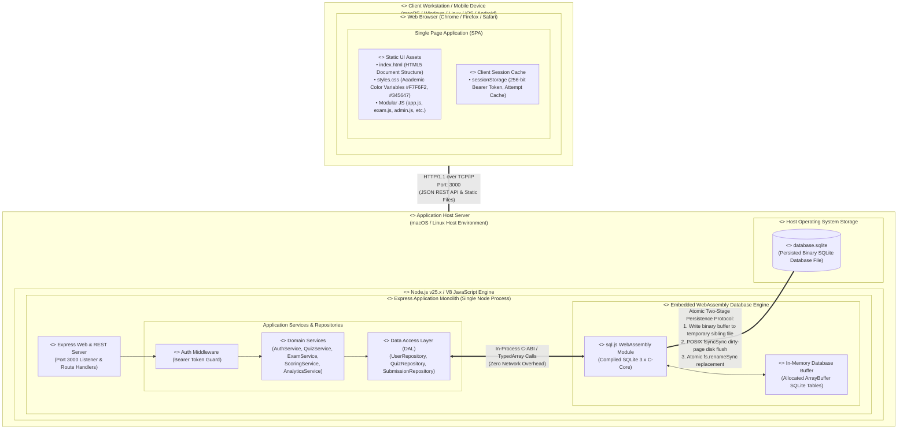

# OOMD Diagram 7: Deployment Diagram

**Project:** Digital Quiz Portal (Online Exam & Assessment Portal)  
**Academic Subject:** Object-Oriented Modeling and Design (OOMD)  
**Authoritative Source:** OOMD Project Report (`docs/OOMD_Report.pdf`, Page 4, Diagram 7)  
**Implementation Source:** Node.js Runtime, WebAssembly SQLite, Persistent Local Storage  
**Status:** **AUDITED: EMBEDDED IN-PROCESS WEBASSEMBLY & ATOMIC PERSISTENCE ALIGNED**

---

## 1. Diagram Purpose & Execution Boundaries

The Deployment Diagram models the physical and execution architecture of the Digital Quiz Portal. It defines:
1. The separation of responsibilities between the **Client Web Browser** and the **Application Host Server**.
2. The runtime hosting model: **Node.js** as the application runtime hosting the single-process Express server.
3. The database execution boundary: **`sql.js` WebAssembly executes entirely inside the Node.js server process memory** (operating on an allocated in-memory `ArrayBuffer`), rather than running as a separate network daemon or external database server.
4. The physical storage architecture: Atomic file replacement and disk synchronization (`fs.fsyncSync`) to the persisted database file (`database.sqlite`).
5. Complete elimination of conflicting, obsolete artifacts from the original OOMD report (external Python/PyTorch ML Server and Java JDBC connections).

---

## 2. Mermaid UML Diagram

---

## 3. Explanation of Hardware & Software Execution Nodes

### 3.1 Client Workstation / Mobile Device (`<<device>>`)
- **Execution Environment:** Any standards-compliant modern web browser.
- **Client Responsibilities:**
  - Renders semantic HTML5 views and executes modular Vanilla JavaScript controllers.
  - Manages client-side visual timer countdown and view navigation.
  - Interacts with backend services via asynchronous JSON calls using native `window.fetch`.
  - Maintains session isolation using `sessionStorage`.

### 3.2 Application Host Server (`<<device>>`)
- **Execution Environment:** Host machine executing Node.js (V8 engine).
- **Single-Process Monolith:** The entire backend runs in a **single operating system process (`node src/app.js`)**:
  - **Express HTTP Server:** Binds to `0.0.0.0:3000`, serving static files from `public/` and handling `/api/*` REST endpoints.
  - **Domain Logic:** Executes asynchronous password hashing (`crypto.scrypt`), session lifecycle management, quiz immutability enforcement, and deterministic grading algorithms.
  - **Embedded WebAssembly SQLite (`sql.js`):** The database engine is **NOT** a separate daemon or network server. It executes as a WebAssembly module directly within the Node.js process heap, manipulating an in-memory `ArrayBuffer`. SQL queries execute via in-process C-ABI function calls with zero network serialization overhead.

### 3.3 Persistence Engine & Local Storage Subsystem
- **Persisted Target:** [`database.sqlite`](file:///Users/soham/Github/Digital-Quiz-Portal/database.sqlite) residing on the host operating system's filesystem.
- **Write-Flush-Rename Atomicity Protocol (`src/database/db.js`):**
  1. `db.save()` exports the active in-memory SQLite WebAssembly byte array.
  2. The byte buffer is written to a unique temporary sibling file in the same directory (`database.sqlite.<ts>.<rnd>.tmp`).
  3. The operating system kernel dirty page cache is flushed to non-volatile physical storage using `fs.fsyncSync(fd)`.
  4. The file descriptor is closed and the temporary file is renamed atomically over `database.sqlite` via `fs.renameSync(tmpPath, destPath)`.
  5. This guarantees that external readers or sudden process terminations will never observe a partially written or corrupted database file.

---

## 4. Architectural Reconciliation with OOMD Report Diagram 7

| Original OOMD Diagram 7 Artifact | Status in Implemented Architecture | Technical Justification for Reconciliation |
| :--- | :---: | :--- |
| **`<<server>> ML Server` (Python / PyTorch)** | **ELIMINATED** | The original report suggested an external machine learning service. This was formally eliminated in Phase 1 to preserve deterministic SQA testing. Cohort analytics are computed via SQL aggregations in [`AnalyticsService`](file:///Users/soham/Github/Digital-Quiz-Portal/src/services/analyticsService.js). |
| **`JDBC Protocol` Connection** | **ELIMINATED** | JDBC is a Java-specific database connectivity protocol. The approved technology stack uses Node.js, Express, and `sql.js` WebAssembly, rendering JDBC obsolete. |
| **`<<server>> Database Server` (External RDBMS)** | **ELIMINATED** | Rather than requiring an external MySQL, PostgreSQL, or Oracle server daemon, the database runs in-process via `sql.js` WebAssembly and persists directly to `database.sqlite`. |
| **Multi-Server Distributed Cluster** | **CONSOLIDATED** | Consolidated into a single-process monolithic deployment model to ensure zero external infrastructure dependencies for academic examination evaluation. |

---

## 5. Source & Report Traceability

| Deployment Element | OOMD Report Source | STQA Report Reference | Implementation Source File |
| :--- | :--- | :--- | :--- |
| **Client Web Browser** | Diagram 7 (`Client PC`) | STQA §1, Page 4–8 | [`public/index.html`](file:///Users/soham/Github/Digital-Quiz-Portal/public/index.html) |
| **HTTP Port 3000** | Diagram 7 (`Web Server`) | STQA §3 (`server.js:3000`) | [`src/app.js`](file:///Users/soham/Github/Digital-Quiz-Portal/src/app.js#L112) |
| **Node.js Express Server** | Diagram 7 (`App Server`) | STQA §3 (Technology Stack) | [`src/app.js`](file:///Users/soham/Github/Digital-Quiz-Portal/src/app.js) |
| **`sql.js` WASM Runtime** | Diagram 7 (Database conflict) | Review Decision 2 | [`src/database/db.js`](file:///Users/soham/Github/Digital-Quiz-Portal/src/database/db.js#L26) |
| **`database.sqlite` Persistence** | Diagram 7 (`Database`) | STQA §3 (`database.sqlite`) | [`src/database/db.js`](file:///Users/soham/Github/Digital-Quiz-Portal/src/database/db.js#L95-L140) |
