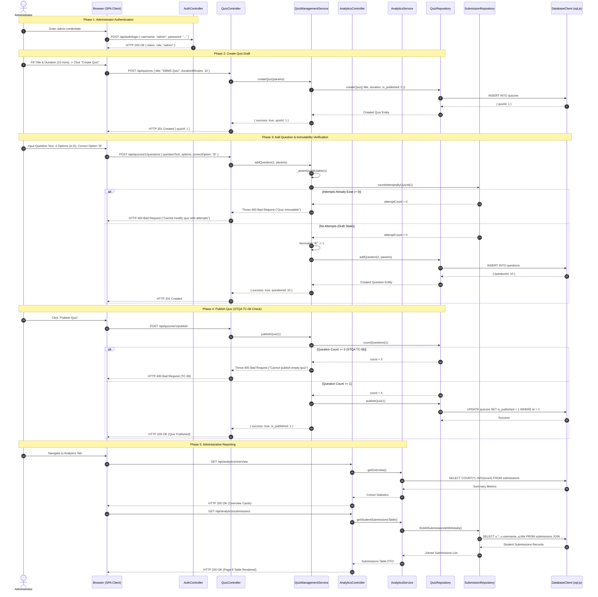

# OOMD Diagram 3: Sequence Diagrams

**Project:** Digital Quiz Portal (Online Exam & Assessment Portal)  
**Academic Subject:** Object-Oriented Modeling and Design (OOMD)  
**Authoritative Source:** OOMD Project Report (`docs/OOMD_Report.pdf`, Page 2, Diagram 3)  
**Implementation Source:** Express Controllers, Domain Services, DAL Repositories  
**Status:** **VERIFIED & RECONCILED WITH IMPLEMENTATION**

---

## 1. Diagram Purpose

The Sequence Diagrams capture the dynamic behavioral interactions, chronological message exchanges, and operational workflows of the Digital Quiz Portal. In accordance with the authoritative OOMD specification and implementation truth, two core interaction flows are modeled:
1. **Flow 1: Student Examination Lifecycle** (Authentication $\to$ Catalog $\to$ Attempt Registration $\to$ Question Fetching $\to$ Answer Submission $\to$ Timer Evaluation $\to$ Scoring $\to$ Results Breakdown).
2. **Flow 2: Administrator Quiz Management Lifecycle** (Authentication $\to$ Quiz Creation $\to$ Question Builder $\to$ Immutability Check $\to$ Publishing Validation $\to$ Cohort Analytics).

---

## 2. Sequence Diagram 3A: Student Examination Lifecycle

```mermaid
sequenceDiagram
    autonumber
    actor Student as Student Candidate
    participant UI as Browser (SPA Client)
    participant AuthCtrl as AuthController
    participant AuthService as AuthService
    participant QuizCtrl as QuizController
    participant QuizService as QuizManagementService
    participant AttemptCtrl as AttemptController
    participant ExamService as ExamService
    participant Scoring as ScoringService
    participant SubRepo as SubmissionRepository
    participant DB as DatabaseClient (sql.js)

    %% 1. Authentication
    Note over Student, AuthService: Phase 1: Authentication & Token Issuance
    Student->>UI: Enter username & password
    UI->>AuthCtrl: POST /api/auth/login { username, password }
    AuthCtrl->>AuthService: login(username, password)
    AuthService->>AuthService: verifyPassword(scrypt)
    AuthService-->>AuthCtrl: { token, user: { id: 2, role: 'student' } }
    AuthCtrl-->>UI: HTTP 200 OK (Bearer Token)
    UI->>UI: Store token in sessionStorage

    %% 2. Browse Published Catalog
    Note over Student, QuizService: Phase 2: Catalog Discovery
    UI->>QuizCtrl: GET /api/quizzes/available (Bearer Token)
    QuizCtrl->>QuizService: getAvailableQuizzes()
    QuizService->>DB: SELECT * FROM quizzes WHERE is_published = 1
    DB-->>QuizService: Published quizzes records
    QuizService-->>QuizCtrl: Array of published quizzes
    QuizCtrl-->>UI: HTTP 200 OK (Quizzes Catalog)

    %% 3. Create or Resume Attempt
    Note over Student, ExamService: Phase 3: Server Attempt Registration
    Student->>UI: Click "Start Exam" for Quiz 1
    UI->>AttemptCtrl: POST /api/quizzes/1/attempts
    AttemptCtrl->>ExamService: startOrResumeAttempt({ userId: 2, quizId: 1 })
    ExamService->>SubRepo: findActiveAttempt(userId, quizId)
    alt Active Attempt Exists
        SubRepo-->>ExamService: Existing attempt (started_at, expires_at)
    else New Attempt
        ExamService->>SubRepo: createAttempt({ userId, quizId, duration: 600s })
        SubRepo->>DB: INSERT INTO submissions (status = 'IN_PROGRESS')
        DB-->>SubRepo: New Attempt Record
    end
    ExamService-->>AttemptCtrl: { attemptId: 101, expiresAt, remainingSeconds }
    AttemptCtrl-->>UI: HTTP 201/200 OK (Attempt Initialized)

    %% 4. Fetch Questions Without Answer Keys
    Note over UI, ExamService: Phase 4: Answer-Key Concealment
    UI->>AttemptCtrl: GET /api/attempts/101/questions
    AttemptCtrl->>ExamService: getAttemptQuestions(101, userId: 2)
    ExamService->>ExamService: Validate Attempt Ownership & Expiry
    ExamService->>DB: SELECT questions (strip correct_option)
    DB-->>ExamService: Sanitized Questions (text, options A-D)
    ExamService-->>AttemptCtrl: DTO without correct answers
    AttemptCtrl-->>UI: HTTP 200 OK (Sanitized Questions)
    UI->>UI: Start visual countdown timer & render question 1

    %% 5. Submit Answers
    Note over Student, DB: Phase 5: Timer Verification & Grading
    Student->>UI: Select answers & click "Submit Exam" (or 00:00 Auto-submit)
    UI->>AttemptCtrl: POST /api/attempts/101/submit { answers: { 1: 0, 2: 1 } }
    AttemptCtrl->>ExamService: submitAttempt({ attemptId: 101, userId: 2, answers })
    ExamService->>ExamService: Read server clock: serverNow = clock()
    
    alt Past 30s Grace Period (serverNow > expiresAt + 30s)
        ExamService->>SubRepo: finalizeSubmission(status = 'FAILED', score = 0)
        ExamService-->>AttemptCtrl: Throw 400 Bad Request ("Attempt Expired")
        AttemptCtrl-->>UI: HTTP 400 Bad Request
    else On-Time or Grace Period
        ExamService->>ExamService: Determine isTimedOut (1 if serverNow > expiresAt else 0)
        ExamService->>DB: SELECT authoritative questions WITH correct_option
        DB-->>ExamService: Questions with answer keys
        ExamService->>Scoring: evaluateSubmission(questions, answers)
        Scoring->>Scoring: Score = sum f(Si, Ci), P = (Score/N)*100
        Scoring->>Scoring: Evaluate status (PASSED if P >= 50.0% else FAILED)
        Scoring-->>ExamService: { score, percentage, status, breakdown }
        
        loop For each question
            ExamService->>SubRepo: recordAnswer(submissionId, questionId, selectedOption, isCorrect)
        end
        ExamService->>SubRepo: finalizeSubmission(attemptId, results)
        ExamService->>DB: db.save() (fsyncSync to database.sqlite)
        ExamService-->>AttemptCtrl: Finalized evaluation results
        AttemptCtrl-->>UI: HTTP 200 OK { score, percentage, status, breakdown }
    end

    %% 6. Review Results
    Note over Student, UI: Phase 6: Result Review & Audit Breakdown
    UI->>UI: Render Results View (Score Card, Green/Red Audit Badges)
```

---

## 3. Sequence Diagram 3B: Administrator Quiz Management Lifecycle

---

## 4. Source & Report Traceability

| Sequence Interaction | OOMD Report Source | STQA Report Reference | Implementation Source File |
| :--- | :--- | :--- | :--- |
| **Authentication Flow** | Diagram 3 (Step 1–2) | STQA §1, TC-01, TC-02 | [`authService.js`](file:///Users/soham/Github/Digital-Quiz-Portal/src/services/authService.js) |
| **Catalog Listing** | Diagram 3 (Step 3–4) | STQA §1, Page 6 | [`quizController.js`](file:///Users/soham/Github/Digital-Quiz-Portal/src/controllers/quizController.js) |
| **Attempt Registration** | Diagram 3 (Exam init) | STQA §3 (`started_at`, `expires_at`) | [`examService.js`](file:///Users/soham/Github/Digital-Quiz-Portal/src/services/examService.js) |
| **Key Concealment** | Diagram 3 (Question fetch) | STQA §1 (Cheating prevention) | [`examService.js`](file:///Users/soham/Github/Digital-Quiz-Portal/src/services/examService.js#L180) |
| **Timer Expiry & Grace Window** | Diagram 3 (Submit step) | Milestone 3 Prereq 2 | [`examService.js`](file:///Users/soham/Github/Digital-Quiz-Portal/src/services/examService.js#L273-L302) |
| **Deterministic Grading** | Diagram 3 (Evaluation) | STQA §1 (Eq 1–3, TC-03..05) | [`scoringService.js`](file:///Users/soham/Github/Digital-Quiz-Portal/src/services/scoringService.js#L85) |
| **Admin Quiz Creation & Immutability** | Diagram 1, 6 | Milestone 3 Prereq 1 | [`QuizManagementService.js`](file:///Users/soham/Github/Digital-Quiz-Portal/src/services/QuizManagementService.js#L415) |
| **Empty Quiz Rejection** | Diagram 1 | STQA TC-06 ($N \ge 1$) | [`QuizManagementService.js`](file:///Users/soham/Github/Digital-Quiz-Portal/src/services/QuizManagementService.js#L363) |
| **Submissions Reporting Table** | Diagram 6 | STQA §1, Page 8 Table | [`analyticsService.js`](file:///Users/soham/Github/Digital-Quiz-Portal/src/services/analyticsService.js#L75) |

---

## 5. Architectural Reconciliation & Modeling Assumptions

1. **Server Clock Authority:** The sequence strictly models server-side receipt time validation (`serverNow = clock()`). Client-supplied receipt times are never trusted.
2. **Persistence Boundary:** Database synchronization is performed via `db.save()` which executes an atomic buffer write and POSIX `fsyncSync` to `database.sqlite` before the HTTP response is returned to the client.
3. **Idempotency Execution:** If a student retries submission for an already finalized attempt, `ExamService` bypasses scoring and returns the pre-computed score, ensuring zero duplicate rows in `submission_answers`.

