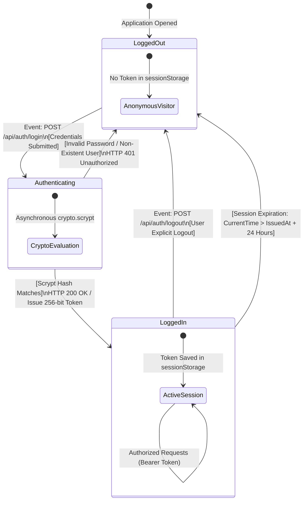
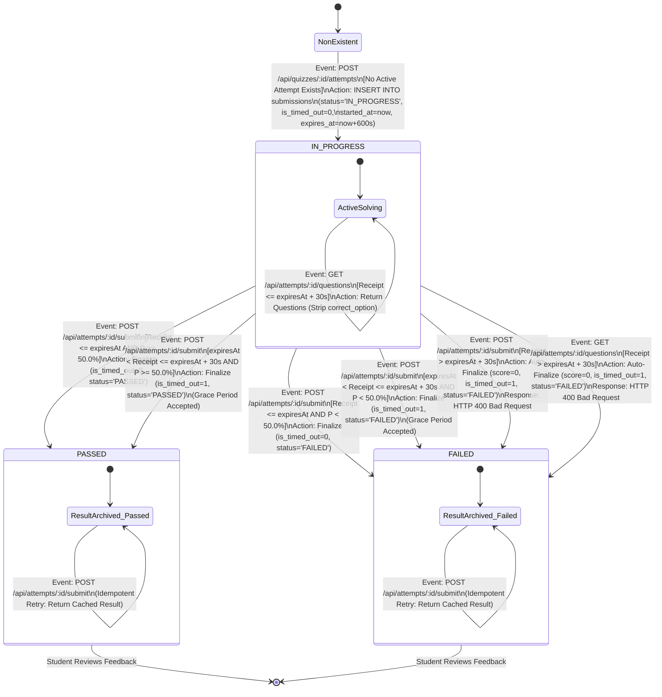

# OOMD Diagram 5: State Machine Diagrams

**Project:** Digital Quiz Portal (Online Exam & Assessment Portal)  
**Academic Subject:** Object-Oriented Modeling and Design (OOMD)  
**Authoritative Source:** OOMD Project Report (`docs/OOMD_Report.pdf`, Page 3, Diagram 5)  
**Implementation Source:** `src/config/constants.js`, `src/database/schema.sql`, `src/services/examService.js`, `src/services/authService.js`  
**Status:** **AUDITED & SEPARATED INTO TWO INDEPENDENT STATE MACHINES**

---

## 1. Diagram Purpose & Scope Separation

In accordance with architectural modeling principles, session authentication and examination attempt lifecycles operate on distinct domain entities with different lifespans and persistence mechanisms. They are therefore modeled as two independent state machines:

1. **State Machine 5A: Authentication Session Lifecycle (`AuthSession` in Memory):** Models user authentication state transitions from anonymous visit to session termination.
2. **State Machine 5B: Examination Attempt Lifecycle (`Submission` in Database):** Models the actual persisted database states (`IN_PROGRESS`, `PASSED`, `FAILED`), timer expiration guards, and submission idempotency.

---

## 2. State Machine 5A: Authentication Session Lifecycle

Models the client session managed by `AuthService` in memory with a 24-hour Time-to-Live (TTL).

### Explanation of Authentication Session States
- **`LoggedOut`:** Initial client state. No valid token exists in the browser's `sessionStorage`.
- **`Authenticating`:** Transient state during asynchronous `crypto.scrypt` verification (16,384 CPU iterations). If verification fails, the system transitions back to `LoggedOut` with HTTP 401.
- **`LoggedIn`:** Active session state. The 256-bit session token is stored in `sessionStorage` and sent in the `Authorization: Bearer <token>` header. Sessions remain valid for 24 hours (`DEFAULT_TTL_MS = 86400000`) unless explicitly revoked via `POST /api/auth/logout`.

---

## 3. State Machine 5B: Examination Attempt Lifecycle (`Submission` Entity)

Models the actual persisted lifecycle of an examination attempt in the SQLite database (`submissions` table) as governed by `ExamService`.

> [!IMPORTANT]
> In the SQLite database schema (`schema.sql:53`), `status` is restricted to exactly three valid enum values: `CHECK(status IN ('IN_PROGRESS', 'PASSED', 'FAILED'))`.
> There is no persisted database state called "GracePeriodActive". The 30-second grace window is modeled strictly as a **guarded time condition** during submission receipt.

---

## 4. Formal State & Transition Specifications

### 4.1 Database Status Values (`schema.sql:53`)
The state machine adheres strictly to the database schema:
- **`IN_PROGRESS`:** The examination attempt has been initialized with server timestamps (`started_at`, `expires_at`). The student can fetch questions and submit answers. Enforced by partial unique index `idx_active_attempt_unique` ensuring at most one active attempt per `(user_id, quiz_id)`.
- **`PASSED`:** Terminal state indicating the student submitted valid answers and achieved an unrounded percentage $P \ge 50.0\%$. Answers are recorded in `submission_answers`.
- **`FAILED`:** Terminal state indicating either:
  1. The student achieved an unrounded percentage $P < 50.0\%$.
  2. The student submitted answers after the 30-second grace window had expired ($T_{\text{receipt}} > T_{\text{expiry}} + 30\text{s}$), resulting in an automatic zero-score failure.

### 4.2 Timer Guard Conditions & Transition Matrix

| Source State | Event / Trigger | Guard Condition | Target State | Persisted Attributes Updated | HTTP Response |
| :--- | :--- | :--- | :---: | :--- | :---: |
| `NonExistent` | `POST /quizzes/:id/attempts` | No active attempt | `IN_PROGRESS` | `status='IN_PROGRESS'`, `is_timed_out=0` | HTTP 201 Created |
| `IN_PROGRESS` | `POST /quizzes/:id/attempts` | Active attempt exists | `IN_PROGRESS` | *No change* (resumes existing) | HTTP 200 OK |
| `IN_PROGRESS` | `POST /attempts/:id/submit` | $T_{\text{receipt}} \le T_{\text{expiry}}$ AND $P \ge 50.0\%$ | `PASSED` | `status='PASSED'`, `is_timed_out=0`, score, submitted_at | HTTP 200 OK |
| `IN_PROGRESS` | `POST /attempts/:id/submit` | $T_{\text{receipt}} \le T_{\text{expiry}}$ AND $P < 50.0\%$ | `FAILED` | `status='FAILED'`, `is_timed_out=0`, score, submitted_at | HTTP 200 OK |
| `IN_PROGRESS` | `POST /attempts/:id/submit` | $T_{\text{expiry}} < T_{\text{receipt}} \le T_{\text{expiry}} + 30\text{s}$ AND $P \ge 50.0\%$ | `PASSED` | `status='PASSED'`, `is_timed_out=1`, score, submitted_at | HTTP 200 OK |
| `IN_PROGRESS` | `POST /attempts/:id/submit` | $T_{\text{expiry}} < T_{\text{receipt}} \le T_{\text{expiry}} + 30\text{s}$ AND $P < 50.0\%$ | `FAILED` | `status='FAILED'`, `is_timed_out=1`, score, submitted_at | HTTP 200 OK |
| `IN_PROGRESS` | `POST /attempts/:id/submit` | $T_{\text{receipt}} > T_{\text{expiry}} + 30\text{s}$ | `FAILED` | `status='FAILED'`, `is_timed_out=1`, `score=0`, `percentage=0.0` | HTTP 400 Bad Request |
| `IN_PROGRESS` | `GET /attempts/:id/questions` | $T_{\text{receipt}} > T_{\text{expiry}} + 30\text{s}$ | `FAILED` | `status='FAILED'`, `is_timed_out=1`, `score=0`, `percentage=0.0` | HTTP 400 Bad Request |
| `PASSED` | `POST /attempts/:id/submit` | Attempt already finalized | `PASSED` | *No change* (Idempotency check) | HTTP 200 OK (Cached) |
| `FAILED` | `POST /attempts/:id/submit` | Attempt already finalized | `FAILED` | *No change* (Idempotency check) | HTTP 200 OK (Cached) |

---

## 5. Source-Code Traceability

| State / Guard / Transition | Implementation Source File | Exact Code Reference |
| :--- | :--- | :--- |
| **`ATTEMPT_STATUS` Constants** | [`src/config/constants.js`](file:///Users/soham/Github/Digital-Quiz-Portal/src/config/constants.js#L25-L29) | `IN_PROGRESS: 'IN_PROGRESS'`, `PASSED: 'PASSED'`, `FAILED: 'FAILED'` |
| **DDL Table Constraint** | [`src/database/schema.sql`](file:///Users/soham/Github/Digital-Quiz-Portal/src/database/schema.sql#L53) | `CHECK(status IN ('IN_PROGRESS', 'PASSED', 'FAILED'))` |
| **Partial Unique Index** | [`src/database/schema.sql`](file:///Users/soham/Github/Digital-Quiz-Portal/src/database/schema.sql#L97) | `idx_active_attempt_unique ... WHERE status = 'IN_PROGRESS'` |
| **Attempt Resumption Logic** | [`src/services/examService.js`](file:///Users/soham/Github/Digital-Quiz-Portal/src/services/examService.js#L125-L135) | `findActiveAttempt(userId, quizId)` |
| **Submission Idempotency Check** | [`src/services/examService.js`](file:///Users/soham/Github/Digital-Quiz-Portal/src/services/examService.js#L238-L270) | `if (attempt.status !== ATTEMPT_STATUS.IN_PROGRESS)` |
| **Post-Grace Timeout Finalization** | [`src/services/examService.js`](file:///Users/soham/Github/Digital-Quiz-Portal/src/services/examService.js#L282-L299) | `if (serverNow > graceExpiresAt) { finalizeSubmission(..., status: FAILED) }` |
| **Grace vs On-Time Flagging** | [`src/services/examService.js`](file:///Users/soham/Github/Digital-Quiz-Portal/src/services/examService.js#L302) | `const isTimedOut = serverNow > expiresAt ? 1 : 0;` |
| **Pass/Fail Decision Function** | [`src/services/scoringService.js`](file:///Users/soham/Github/Digital-Quiz-Portal/src/services/scoringService.js#L149-L151) | `rawPercentage >= PASS_THRESHOLD_PERCENT ? PASSED : FAILED` |
