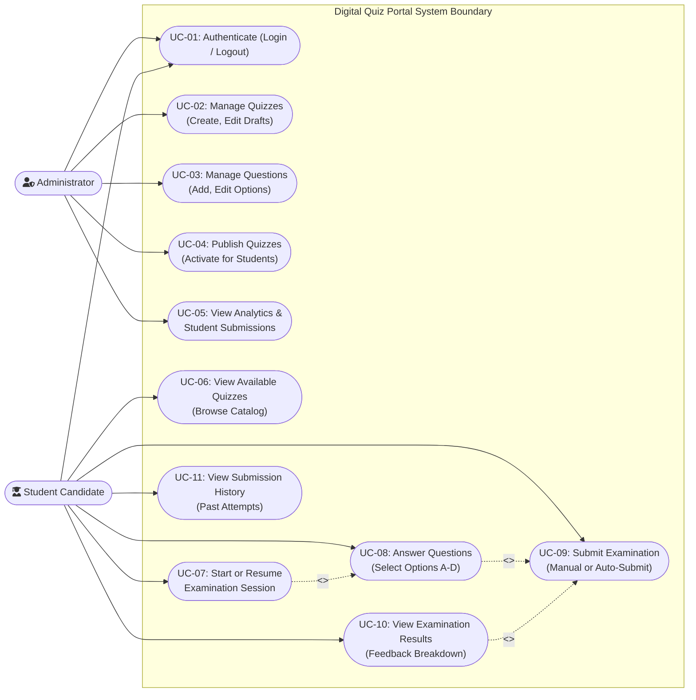

# OOMD Diagram 1: Use Case Diagram

**Project:** Digital Quiz Portal (Online Exam & Assessment Portal)  
**Academic Subject:** Object-Oriented Modeling and Design (OOMD)  
**Authoritative Source:** OOMD Project Report (`docs/OOMD_Report.pdf`, Page 1, Diagram 1)  
**Implementation Source:** Express REST API Controllers & Frontend Views  
**Status:** **AUDITED & REFINED: ACTOR-GOAL FOCUSED SPECIFICATION**

---

## 1. Diagram Purpose & Modeling Philosophy

In accordance with standard Object-Oriented Modeling and Design (OOMD) principles, **use cases represent primary actor goals**—what an actor seeks to achieve when interacting with the system.

Internal system subroutines, cryptographic calculations (`scrypt` hashing), data-projection filters (answer-key concealment), validation triggers (TC-06 empty quiz check), and timer mathematical formulations are **system constraints, business rules, and execution details** rather than independent actor goals. They are documented as use-case constraints and business logic rather than cluttering the diagram as synthetic use cases.

---

## 2. Mermaid UML Diagram

---

## 3. Explanation of Actor Goals (Use Cases)

### 3.1 Primary Actors
1. **Administrator (`Admin`):** An authorized faculty member or instructor responsible for managing academic assessments, defining question banks, publishing exams, and analyzing cohort results.
2. **Student Candidate (`Student`):** An authenticated student who browses available exams, takes timed tests with single-question navigation, and reviews grading audit breakdowns.

### 3.2 Actor Goals Description

| Use Case ID | Actor Goal | Primary Actor | Associated REST API Endpoint | Underlying Business Rules & Internal System Constraints |
| :--- | :--- | :---: | :--- | :--- |
| **UC-01** | **Authenticate (Login / Logout)** | Admin & Student | `POST /api/auth/login` `POST /api/auth/logout` | **Constraint:** Asynchronous `crypto.scrypt` verification (16,384 iterations) with constant-time equality. Issues 256-bit opaque Bearer token with 24-hour TTL in `sessionStorage`. |
| **UC-02** | **Manage Quizzes** | Admin | `POST /api/quizzes` `GET /api/quizzes/:id` | **Constraint:** Quizzes default to 10-minute duration and draft state (`is_published = 0`). **Immutability Lock:** Modifications are blocked once student attempts exist. |
| **UC-03** | **Manage Questions** | Admin | `POST /api/quizzes/:id/questions` | **Constraint:** Questions must have question text, exactly 4 non-empty options (A, B, C, D), and a normalized correct option (0..3). Guarded by immutability lock. |
| **UC-04** | **Publish Quizzes** | Admin | `POST /api/quizzes/:id/publish` | **Constraint (STQA TC-06):** System strictly asserts $N \ge 1$ questions before toggling `is_published = 1`. Empty quizzes are rejected with HTTP 400 Bad Request. |
| **UC-05** | **View Analytics & Submissions** | Admin | `GET /api/analytics/overview` `GET /api/analytics/submissions` | **Constraint:** Executes deterministic SQL aggregations for cohort summaries and populates the STQA Report Results Page 8 table. Access restricted to `admin` role. |
| **UC-06** | **View Available Quizzes** | Student | `GET /api/quizzes/available` | **Constraint:** Filters and returns only quizzes where `is_published = 1`. Draft quizzes remain concealed. Access restricted to `student` role. |
| **UC-07** | **Start or Resume Examination** | Student | `POST /api/quizzes/:id/attempts` | **Constraint:** Server registers `started_at` and `expires_at`. Enforces partial unique index `idx_active_attempt_unique` preventing duplicate active attempts; resumes if active. |
| **UC-08** | **Answer Questions** | Student | `GET /api/attempts/:id/questions` Client Navigation | **Constraint (Answer-Key Concealment):** Server projects sanitized DTO completely stripping `correct_option`. Client navigates questions via palette pills and selects A–D radio choices. |
| **UC-09** | **Submit Examination** | Student | `POST /api/attempts/:id/submit` | **Constraint (Server Clock Authority):** Validated against server clock with 30s grace window. Graded deterministically ($P = S/N \times 100 \ge 50.0\%$). Atomic `fsyncSync` persistence. Idempotent on retry. |
| **UC-10** | **View Examination Results** | Student | `GET /api/attempts/:id/results` | **Constraint:** Displays question-by-question audit breakdown (student choices, correct keys, green/red badges). Access restricted to attempt owner. |
| **UC-11** | **View Submission History** | Student | `GET /api/attempts/history` | **Constraint:** Retrieves list of past completed submissions with scores, percentages, and statuses for the authenticated student. |

---

## 4. Source & Report Traceability

| Use Case | OOMD Report Source | STQA Report Reference | Implementation Source File |
| :--- | :--- | :--- | :--- |
| **UC-01: Authenticate** | Diagram 1 (`Login`) | STQA §1, TC-01, TC-02 | [`authController.js`](file:///Users/soham/Github/Digital-Quiz-Portal/src/controllers/authController.js) |
| **UC-02: Manage Quizzes** | Diagram 1 (`Manage Quizzes`) | STQA §1 Overview | [`quizController.js`](file:///Users/soham/Github/Digital-Quiz-Portal/src/controllers/quizController.js) |
| **UC-03: Manage Questions** | Diagram 1 (`Add Questions`) | STQA §1, Page 4–5 | [`quizController.js`](file:///Users/soham/Github/Digital-Quiz-Portal/src/controllers/quizController.js) |
| **UC-04: Publish Quizzes** | Diagram 1 (`Publish Quiz`) | STQA TC-06 ($N \ge 1$) | [`quizController.js`](file:///Users/soham/Github/Digital-Quiz-Portal/src/controllers/quizController.js) |
| **UC-05: View Analytics** | Diagram 1 (`View Analytics`) | STQA §1, Page 8 Table | [`analyticsController.js`](file:///Users/soham/Github/Digital-Quiz-Portal/src/controllers/analyticsController.js) |
| **UC-06: View Catalog** | Diagram 1 (`View Available Quizzes`) | STQA §1, Page 6 | [`quizController.js`](file:///Users/soham/Github/Digital-Quiz-Portal/src/controllers/quizController.js) |
| **UC-07: Start / Resume Exam**| Diagram 1 (`Take Quiz`) | STQA §3 (`started_at`, `expires_at`) | [`attemptController.js`](file:///Users/soham/Github/Digital-Quiz-Portal/src/controllers/attemptController.js) |
| **UC-08: Answer Questions** | Diagram 1 (`Take Quiz`) | STQA §1, Page 7 | [`exam.js`](file:///Users/soham/Github/Digital-Quiz-Portal/public/js/exam.js) |
| **UC-09: Submit Examination** | Diagram 1 (`Submit Answers`) | STQA §1 (Eq 1–3, TC-03..05) | [`attemptController.js`](file:///Users/soham/Github/Digital-Quiz-Portal/src/controllers/attemptController.js) |
| **UC-10: View Results** | Diagram 1 (`View Results`) | STQA §1, Page 7 Breakdown | [`attemptController.js`](file:///Users/soham/Github/Digital-Quiz-Portal/src/controllers/attemptController.js) |
| **UC-11: View History** | Diagram 1 (`View Results`) | STQA §1, Page 6 | [`attemptController.js`](file:///Users/soham/Github/Digital-Quiz-Portal/src/controllers/attemptController.js) |

---

## 5. Architectural Reconciliation & Modeling Assumptions

1. **Actor-Goal Purity:** The diagram strictly restricts use-case bubbles to primary user intentions. Technical mechanisms (such as `crypto.scrypt`, DTO answer stripping, and `fsyncSync` file writes) are documented in Section 3 as business rules rather than standalone use-case ovals.
2. **Two-Stage Examination REST Flow:** Attempt initialization (`UC-07`) is separated from answering questions (`UC-08`), matching the RESTful architectural requirement that prevents state mutation side effects on GET requests.
3. **Immutability and Publishing Constraints:** Preconditions for publishing (TC-06) and modifying quizzes are modeled as operational rules enforced by the backend service.
