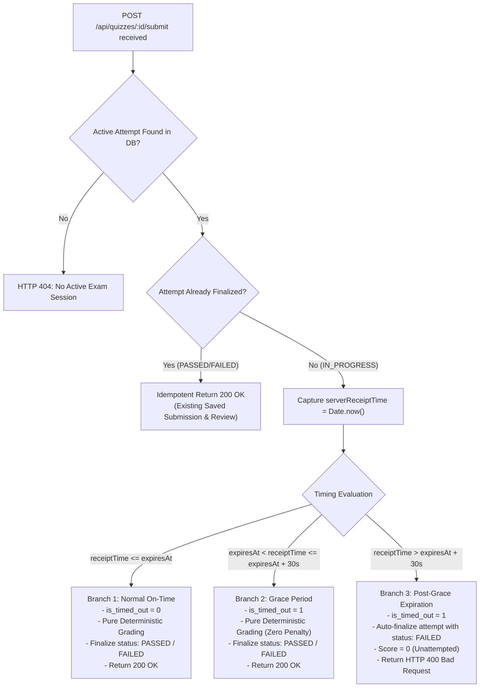
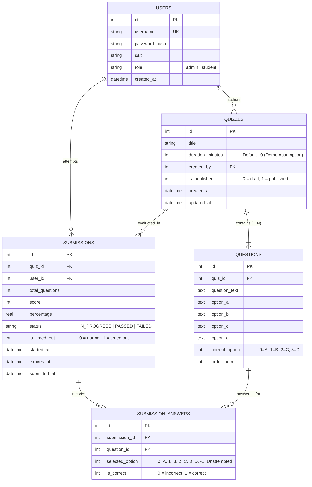
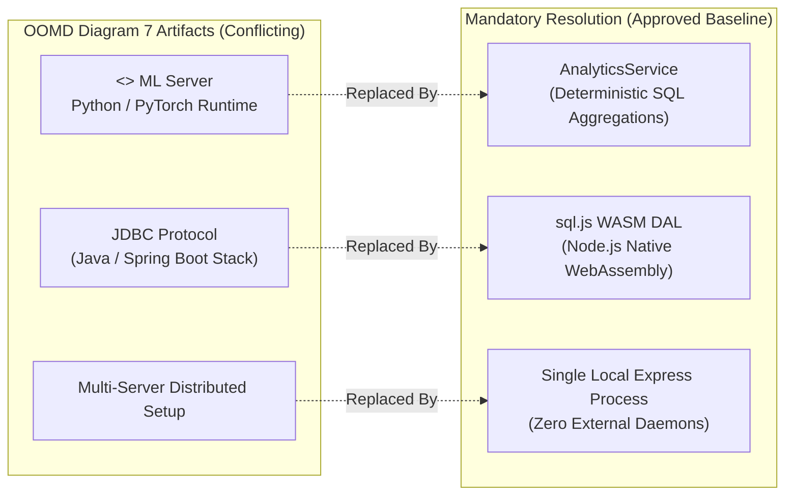

# Digital Quiz Portal (Online Exam & Assessment Portal)
## AI-DLC Phase 1: Inception & Requirements Engineering Specification (Final Approved Baseline)

**Academic Subjects:** Software Testing & Quality Assurance (STQA - LP-IV) & Object-Oriented Design and Modeling (OOMD)  
**Institution:** Marathwada Mitra Mandal's College of Engineering (MMCOE), Pune (Autonomous Institute affiliated to SPPU)  
**Authors / Project Team:** Ashlesha Gosavi (BC127), Divya Lokhande (BC136), Bhakti Pate (BC146)  
**Academic Year:** 2026–27 | Semester-VII  
**Phase Status:** Phase 1 Architecture Decisions Approved & Finalized — Approved Baseline. *(Implementation has not begun).*

---

## 1. Requirements Classification Taxonomy

To ensure absolute clarity and traceability between academic documentation, architectural integrity, and implementation scope, every requirement and architectural decision in this specification is categorized under one of three explicit tiers:

- **[Category A] Report-Mandated Requirements:** Directly and unambiguously specified in the authoritative STQA Mini-Project Report and/or OOMD UML Report.
- **[Category B] Necessary Implementation Decisions & Assumptions:** Architectural, engineering, and configuration decisions required to execute the specifications within the mandatory technology stack (`sql.js`, Node.js, Express, Vanilla JS) while resolving documentation gaps or contradictions.
  - *Explicit Implementation Assumptions:*
    1. A default examination duration of **10 minutes** for demonstration purposes.
    2. A network transmission grace period of **30 seconds** beyond the timer expiration timestamp.
    3. An opaque cryptographically random server-side session token mechanism.
- **[Category C] Security & Robustness Enhancements:** Industry-standard security practices (e.g. asynchronous `scrypt` hashing, constant-time `timingSafeEqual()` comparisons, and question DTO projection) that safeguard examination integrity without altering academic algorithms or user workflows.

---

## 2. Report Requirements Extraction

### 2.1 Project Description & Core Objectives
- **Domain:** Web-based academic examination management and assessment automation platform.
- **Core Objectives [A]:**
  1. Automate the complete examination lifecycle: quiz authoring, question drafting, publishing, student examination delivery, response collection, deterministic auto-grading, and administrative performance analytics.
  2. Enforce strict Role-Based Access Control (RBAC) separating **Admin** capabilities (quiz creation, question authoring, publishing, score review) from **Student** capabilities (viewing published examinations, taking exams, submitting answers, receiving immediate score and question feedback).
  3. Validate rigorous Software Quality Assurance (SQA) methodologies: deterministic grading, black-box testing (Equivalence Partitioning, Boundary Value Analysis, Decision Table Testing), white-box testing (Branch and Path Coverage), and automated REST API verification without relying on external or stochastic components.
  4. Ensure zero-dependency local execution: run locally on Node.js using an embedded WebAssembly SQLite engine (`sql.js`) with persistent file backup (`database.sqlite`).

### 2.2 Mathematical Formulations & Deterministic Scoring Algorithm [A]
*(Source: STQA Report Page 1 Section 1, "Automated Score Calculation & Feedback Algorithm")*

1. **Raw Score Formulation:**
   $$Score = \sum_{i=1}^{N} f(S_i, C_i)$$
   Where:
   - $N$: Total number of questions in the quiz ($N \ge 1$).
   - $S_i$: Selected option index for question $i$.
   - $C_i$: Correct option index for question $i$.
   - Indicator function:
     $$f(S_i, C_i) = \begin{cases} 1 & \text{if } S_i = C_i \\ 0 & \text{if } S_i \neq C_i \text{ or unattempted} \end{cases}$$

2. **Percentage Score Computation:**
   $$Percentage (P) = \left( \frac{Score}{N} \right) \times 100$$

3. **Pass / Fail Decision Function:**
   $$Status = \begin{cases} \text{"PASSED"} & \text{if } P \ge T_{pass} \\ \text{"FAILED"} & \text{if } P < T_{pass} \end{cases}$$
   Where $T_{pass} = 50.0\%$.

4. **Question-by-Question Feedback Breakdown:**
   For every question $i \in \{1, \dots, N\}$, the engine produces an evaluation record containing:
   - Question text
   - Student's selected option ($S_i$)
   - Correct answer option ($C_i$)
   - Correctness boolean: $isCorrect = (S_i == C_i)$

### 2.3 Boundary Value Analysis (BVA) & Equivalence Partitioning (EP) Model [A]
*(Source: STQA Report Page 1–2, Section 2)*

#### Equivalence Partitioning (EP) Matrix
| Input Condition | Valid Partition | Invalid Partition |
| :--- | :--- | :--- |
| **Score Percentage ($P$)** | $0 \le P \le 100$ | $P < 0$ or $P > 100$ |
| **Authentication Credentials** | Registered Username + Correct Password | Unregistered Username OR Wrong Password |
| **Quiz Questions Count ($N$)** | $N \ge 1$ | $N = 0$ (Empty quiz rejection) |

#### Boundary Value Analysis (BVA) for Pass/Fail ($T_{pass} = 50.0\%$)
| Boundary Classification | Test Value ($P$) | Expected Engine Outcome |
| :--- | :--- | :--- |
| **Min- / Extreme Out-of-Bound** | $-1.0\%$ | Error: Invalid Input Domain |
| **Min / Extreme Low Boundary** | $0.0\%$ | `FAILED` |
| **Just Below Pass Boundary** | $49.9\%$ | `FAILED` |
| **Exact Pass Boundary** | $50.0\%$ | `PASSED` |
| **Max Boundary** | $100.0\%$ | `PASSED` |
| **Max+ / Extreme Out-of-Bound** | $101.0\%$ | Error: Invalid Input Domain |

### 2.4 Test Case Execution Matrix [A]
*(Source: STQA Report Page 8–9, "STQA Test Case Execution Matrix")*

| Test ID | Test Scenario | Technique | Test Input Data | Expected Outcome | Actual / Target Status |
| :--- | :--- | :--- | :--- | :--- | :--- |
| **TC-01** | Verify Admin Sign-in | Equivalence Partitioning | `admin` / `admin123` | HTTP 200, Role: Admin | PASS |
| **TC-02** | Reject Invalid Passwords | Equivalence Partitioning | `admin` / `invalid` | HTTP 401, Error Message | PASS |
| **TC-03** | Auto-Grading (100% Score) | Unit Logic | Answers: `{1: 'B'}` (all correct) | Score: 1/1, Status: `PASSED` | PASS |
| **TC-04** | Auto-Grading (0% Score) | Boundary Value Analysis | Answers: `{1: 'A'}` (incorrect) | Score: 0/1, Status: `FAILED` | PASS |
| **TC-05** | Empty Exam Submission | Negative Testing | Answers: `{}` (unattempted) | Score: 0/1, Percentage: 0%, `FAILED` | PASS |
| **TC-06** | Quiz Publishing Validation | Integration Testing | Empty Question Array `questions: []` | HTTP 400 Bad Request | PASS |

### 2.5 Quality & Performance Metrics [A]
*(Source: STQA Report Page 9)*
- **Execution Efficiency:** Automated tests via Jest execute 100% of API unit tests in $< 1.5$ seconds.
- **Defect Density:** 0 critical defects.
- **DOM & Network Latency:** DOM rendering and response delivery under $200\text{ ms}$.

### 2.6 OOMD UML Diagrams Extraction [A]
*(Source: OOMD Report Pages 1–4, Diagrams 1 through 7)*
1. **Diagram 1 (Use Case):** Identifies `Admin` and `Student` actors; use cases: `Login`, `Manage Quizzes` (`Create Quiz`, `Publish Quiz`), `View Analytics`, `Take Quiz` (`Submit Answers`), `View Results`, `Logout`.
2. **Diagram 2 (Class):** Conceptual entities `User` (base for `Admin`, `Student`), `Quiz`, `Question`, `Submission`, `AuthService`, `ScoringService`.
3. **Diagram 3 (Sequence):** Examination lifecycle sequence: authentication $\rightarrow$ quiz listing $\rightarrow$ questions fetch $\rightarrow$ submit answers $\rightarrow$ score evaluation $\rightarrow$ feedback review.
4. **Diagram 4 (Activity):** Operational workflows branching by credentials validity and user role.
5. **Diagram 5 (State Machine):** User lifecycle: `LoggedOut` $\leftrightarrow$ `Authenticating` $\rightarrow$ `LoggedIn` (`Dashboard` $\rightarrow$ `ExamInProgress` $\rightarrow$ `Submitted` $\rightarrow$ `Evaluated` $\rightarrow$ `Dashboard`).
6. **Diagram 6 (Component):** Browser views $\rightarrow$ REST API Router $\rightarrow$ Domain Services (`Authentication`, `Quiz Management`, `Scoring`, `Analytics`) $\rightarrow$ Data Access Layer $\rightarrow$ Quiz Database.
7. **Diagram 7 (Deployment):** Physical deployment diagram showing client devices, web server, application server, database server, and external ML runtime. *(See Section 8 for architectural reconciliation).*

---

## 3. Functional Requirements (FR) Catalog

| FR ID | Category | Requirement Description | Source Traceability |
| :--- | :---: | :--- | :--- |
| **FR-01** | **[A]** | **User Authentication & Role Identification:** Provide secure authentication for Admin and Student accounts, issuing session state and returning the authenticated user's role (`admin` or `student`) and identity metadata. | STQA Report §2 (TC-01, TC-02); OOMD Diagram 1, 2, 3, 4, 5 |
| **FR-02** | **[A]** | **Session Termination (Logout):** Invalidate client session token in the session store and return the user to the portal sign-in view. | STQA Report §2; OOMD Diagram 1, 2, 4, 5 |
| **FR-03** | **[A]** | **Quiz Creation:** Allow Admin to create a new quiz specifying an examination title and optional duration. | STQA Report §2; OOMD Diagram 1, 2, 4, 6 |
| **FR-04** | **[A]** | **Question Definition & 4-Option Builder:** Allow Admin to add multiple-choice questions to a quiz. Each question must have question text, exactly 4 option choices (A, B, C, D), and a designated correct answer. | STQA Report §2, Results Page 4–5; OOMD Diagram 1, 2, 4 |
| **FR-05** | **[B]** | **Normalized Question Option Storage:** Store correct answers internally as zero-indexed integers ($0=\text{A}, 1=\text{B}, 2=\text{C}, 3=\text{D}$). Support both integer indices and letter inputs in the API, returning standard letters to the client. | Architecture Review Decision 3; STQA TC-03; OOMD Diagram 2 |
| **FR-06** | **[A]** | **Empty Quiz Publishing Rejection:** Prevent publishing quizzes that contain 0 questions, returning HTTP 400 Bad Request with an explicit error message (`"Cannot publish empty quiz without questions"`). | STQA Report §2 (EP Matrix), §8 (TC-06) |
| **FR-07** | **[A]** | **Quiz Publishing Workflow:** Allow Admin to publish validated quizzes, toggling `isPublished` from `0` to `1` so they become visible to students. | STQA Report §2; OOMD Diagram 1, 2, 4 |
| **FR-08** | **[A]** | **Student Examination Catalog:** Display all published quizzes to authenticated students with title, author, question count, duration, and an action to attempt the exam. Unpublished drafts remain hidden. | STQA Report Results Page 6; OOMD Diagram 1, 2, 3, 4 |
| **FR-09** | **[C]** | **Answer-Key Protection (Question Projection DTO):** When delivering active exam questions to a student, use a dedicated projection DTO that strictly strips and omits `correct_option`. Correct answers must never be sent prior to submission. | Architecture Review Decision 4; OOMD Diagram 3 |
| **FR-10** | **[A]** | **Examination Attempt & Response Collection:** Provide an interactive examination player where students can navigate questions, select radio options (A, B, C, D) for each question, review selections, and submit answers. | STQA Report Results Page 7; OOMD Diagram 1, 3, 4, 5 |
| **FR-11** | **[B]** | **Configurable Examination Timer:** Allow quizzes to have a configurable duration (`duration_minutes`). Default to **10 minutes** for demonstration purposes (*explicit implementation assumption*). | Architecture Review Decision 6; STQA Report §2, §3 |
| **FR-12** | **[B]** | **Server-Side Attempt Registration & Expiry Generation:** Attempt creation and resumption is handled explicitly via `POST /api/quizzes/:id/attempts` (preventing mutation side effects on GET requests). The server ensures duplicate requests cannot create multiple active attempts for the same student and quiz, returning the existing or newly created active attempt with `started_at` and `expires_at`. Questions are subsequently retrieved via `GET /api/attempts/:attemptId/questions`. | Architecture Decision Review Amendments; STQA Report §3 |
| **FR-13** | **[B]** | **Frontend Countdown & Auto-Submission:** The client executes a continuous visual countdown. Upon reaching `00:00`, it automatically dispatches the current state of answers to the submission endpoint. | STQA Report §2 ("client-side timer management"); Architecture Review Decision 6 |
| **FR-14** | **[B]** | **Server Receipt Time Validation & Grace Period Handling:** The server validates submission timing exclusively using its own receipt timestamp (`new Date()`), never trusting client timestamps. Handled via three strict branches: (1) On-Time ($Receipt \le expiresAt$), (2) Grace Period ($expiresAt < Receipt \le expiresAt + 30s$) marked `is_timed_out: 1` with zero score penalty, (3) Post-Grace ($Receipt > expiresAt + 30s$) rejected with HTTP 400 Bad Request and attempt auto-finalized as failed. | Architecture Decision Review Amendment 1 |
| **FR-15** | **[B]** | **Idempotent Submission Finalization:** An examination attempt must be finalized idempotently. Re-submitting an already finalized attempt (e.g. from network retry) returns the existing recorded result without re-grading or duplicating records. | Architecture Decision Review Amendment 1 |
| **FR-16** | **[A]** | **Deterministic Score Calculation:** Compute raw score as the sum of correct answers ($Score = \sum f(S_i, C_i)$), where unattempted or omitted answers are strictly evaluated as 0. All grading executes exclusively on the backend comparing integer indices. | STQA Report §1 (Algorithms); Architecture Review Decision 3 & 4 |
| **FR-17** | **[A]** | **Percentage Calculation:** Compute percentage as $(Score / N) \times 100$, strictly formatted to 1 decimal place or integer percentage representation. | STQA Report §1 (Algorithms) |
| **FR-18** | **[A]** | **Pass/Fail Decision:** Assign `PASSED` status if $Percentage \ge 50.0\%$, and `FAILED` if $Percentage < 50.0\%$. | STQA Report §1 (Algorithms), §2 (BVA Model) |
| **FR-19** | **[A]** | **Submission Persistence:** Persist every exam attempt into the database with `student_id`, `quiz_id`, `score`, `percentage`, `status`, `started_at`, `submitted_at`, and `is_timed_out`. | STQA Report §3 (`server.js`); OOMD Diagram 2, 3, 6 |
| **FR-20** | **[A]** | **Question-by-Question Feedback Breakdown:** Return an immediate post-submission audit breakdown showing question text, student's submitted choice, correct answer, and correctness indicator for each question. | STQA Report §1, Results Page 7; OOMD Diagram 1, 2, 3, 4, 5 |
| **FR-21** | **[A]** | **Administrative Scores & Analytics:** Provide Admin with a consolidated tabular report of all student submissions (Student, Quiz Title, Score, Percentage, Pass/Fail Status, Submission Time). | STQA Report Results Page 8; OOMD Diagram 1, 2, 4, 6 |
| **FR-22** | **[B]** | **Deterministic Summary Performance Metrics:** Calculate cohort analytics (total submissions, pass rate percentage, average cohort score) using deterministic SQL aggregation via `AnalyticsService`. | Architecture Review Decision 1; OOMD Diagram 6 |

---

## 4. Non-Functional Requirements (NFR) Catalog

| NFR ID | Category | Requirement Description | Source Traceability |
| :--- | :---: | :--- | :--- |
| **NFR-01** | **[A]** | **Technology Stack Conformance:** Strictly implement using Node.js, Express.js, `sql.js` (WebAssembly SQLite), HTML5, CSS3, and Vanilla JavaScript. External database servers, Java/Spring Boot, frontend frameworks (React/Vue/Angular), and ML runtimes (Python/PyTorch) are forbidden. | Project Specification §2; STQA Report §3 |
| **NFR-02** | **[A]** | **Zero-Dependency Local Execution:** The system must launch self-sufficiently with `npm install` and `npm start` without requiring external database daemons, container runtimes, or cloud credentials. | Project Specification §2, §6; STQA Report §3 |
| **NFR-03** | **[A]** | **Deterministic Auto-Grading Invariance:** Auto-grading must be completely deterministic and free of race conditions, float precision errors, or stochastic variability. Identical submission answers must yield identical scores and pass/fail states every time. | STQA Report §1, §2 |
| **NFR-04** | **[A]** | **Data Persistence & File Synchronization:** The in-memory `sql.js` SQLite database must export to `database.sqlite` on disk upon startup initialization, seeding, and mutation transactions. Existing data must reload seamlessly upon server restart. | STQA Report §3 (`saveDatabase()` & `initDB()`); Project Specification §6 |
| **NFR-05** | **[C]** | **Asynchronous Cryptographic Security:** Passwords must be hashed using Node.js's built-in asynchronous `crypto.scrypt()` with a unique cryptographically random salt (`crypto.randomBytes(16)`). Password verification must use `crypto.timingSafeEqual()` to eliminate timing attacks. Synchronous hashing in Express request handlers is strictly prohibited. Password hashes and salts must never be serialized or exposed in API responses. | Architecture Review Decision 5; Amendment 2 |
| **NFR-06** | **[B]** | **Opaque Cryptographic Session Tokens:** Sessions are managed using 32-byte cryptographically secure random hexadecimal tokens (`crypto.randomBytes(32).toString('hex')`) transmitted via `Authorization: Bearer <token>`. Sessions are tracked in a thread-safe server store with role enforcement. | Architecture Decision Review Amendment 2 |
| **NFR-07** | **[A]** | **Execution Speed & Test Performance:** The entire Jest automated testing suite (including unit, boundary, equivalence, and Supertest REST API tests) must execute in $< 1.5$ seconds locally. | STQA Report §9 ("Execution Efficiency") |
| **NFR-08** | **[A]** | **Response Latency:** REST API endpoints must respond in $< 50\text{ ms}$ under local conditions; client DOM rendering transitions must complete in $< 200\text{ ms}$. | STQA Report §9 ("Compatibility Analysis") |
| **NFR-09** | **[A]** | **Academic Editorial UI/UX Aesthetics:** The web interface must present an understated, high-legibility academic aesthetic: warm off-white canvas (`#FBFBFA`), deep charcoal text (`#1F2421`), muted forest green (`#2D5A27`) and restrained terracotta (`#A04000`) accents, clear typographic hierarchy, subtle borders, and zero AI neon gradients or superfluous animations. | Project Specification §7; STQA Report Screenshots |
| **NFR-10** | **[A]** | **Responsive Layout:** All views (Login, Admin Builder, Analytics, Student Exam, Feedback) must adapt smoothly across desktop ($1920\times 1080$), tablet ($768\text{px}$), and mobile ($375\text{px}$) viewports. | Project Specification §7 |
| **NFR-11** | **[B]** | **Layered Architectural Separation:** Code must maintain strict separation of concerns across HTTP Controllers, Domain Services, Data Access Layer, and Presentation UI. No business logic in controllers; no database queries in route handlers. | Project Specification §5; OOMD Diagram 6 |

---

## 5. Report-to-Implementation Traceability Matrix

| Requirement / Component | Category | STQA Report Citation | OOMD Report Citation | Implementation Target |
| :--- | :---: | :--- | :--- | :--- |
| **User Entity & Roles** | [A] | §2 Overview (RBAC); §3 Server | Diagram 2 (`User`, `Admin`, `Student`) | `src/models/User.js`, `src/services/authService.js` |
| **Async Scrypt Hashing & timingSafeEqual** | [C] | §2 Credentials partition | Diagram 2 (`AuthService`) | `src/services/authService.js` (`crypto.scrypt`) |
| **Bearer Session Token Store** | [B] | §2 (Authentication state) | Diagram 3 (`Session / token + role`) | `src/middleware/authMiddleware.js` |
| **Auth & Login API** | [A] | §8 (TC-01, TC-02); Page 4 Screenshot | Diagram 1, 3, 4, 5, 6 (`Authentication Service`) | `POST /api/auth/login`, `src/controllers/authController.js` |
| **Quiz & Question Model** | [A] | §2 Quiz Count ($N \ge 1$); Page 4–5 | Diagram 2 (`Quiz`, `Question`), Diagram 6 | `src/models/Quiz.js`, `src/models/Question.js` |
| **Option Representation & Normalization** | [B] | §8 (TC-03 `{1: 'B'}`) | Diagram 2 (`options: List<String>`, `correctIndex`) | `src/dal/quizRepository.js`, `src/services/quizService.js` |
| **Quiz Creation & Editor** | [A] | §2 Overview; Page 4–5 Screenshots | Diagram 1, 2, 4, 6 (`Quiz Management Service`) | `POST /api/quizzes`, `src/controllers/quizController.js` |
| **Quiz Publishing & Validation** | [A] | §2 EP Matrix ($N=0$ invalid); §9 (TC-06) | Diagram 1, 2, 4 (`publishQuiz`) | `PUT /api/quizzes/:id/publish`, `quizService.js` |
| **Exam Listing for Students** | [A] | §2 Overview; Page 6 Screenshot | Diagram 1, 3, 4 (`viewExams`) | `GET /api/quizzes`, `src/controllers/quizController.js` |
| **Question Projection DTO (No Key)** | [C] | §2 Overview (Cheating prevention) | Diagram 3 (`GET /quizzes/{id}/questions`) | `GET /api/quizzes/:id/questions`, `quizService.js` |
| **Server Attempt Registration (`startedAt`, `expiresAt`)** | [B] | §2 ("timer handling"), §3 | Diagram 3 (Exam questions request) | `submissions.started_at`, `submissions.expires_at` |
| **Server Receipt Timestamp Validation** | [B] | §3 ("timer timeouts") | Diagram 3 (`POST /submit`) | `src/controllers/submissionController.js` |
| **Grace Period & Timeout Marking** | [B] | §2 (Timer handling) | Diagram 3 (`Save submission`) | `submissions.is_timed_out`, `scoringService.js` |
| **Post-Grace Finalization & Rejection** | [B] | §2 (Negative Testing) | Diagram 3 (`alt [invalid]`) | `submissionController.js` (HTTP 400) |
| **Idempotent Submission Processing** | [B] | SQA Architecture Robustness | Diagram 3 (`POST /submit`) | `src/services/submissionService.js` |
| **Scoring Formula & Logic** | [A] | §1 Algorithms ($Score, P, Status$); TC-03, 04, 05 | Diagram 2, 3, 6 (`ScoringService.evaluate`) | `src/services/scoringService.js` |
| **Immediate Score & Feedback** | [A] | §1 Feedback Breakdown; Page 7 Screenshot | Diagram 1, 2, 3, 4, 5 (`viewFeedback`) | `SubmissionResult` payload, `feedbackView.js` |
| **Admin Analytics & Scores** | [A] | §2 Overview; Page 8 Screenshot | Diagram 1, 2, 4, 6 (`Analytics Service`) | `GET /api/admin/submissions`, `GET /api/admin/analytics` |
| **Deterministic SQL Analytics** | [B] | §2 (No ML focus); Page 8 Screenshot | Diagram 6 (`Analytics Service`), Diagram 7 Conflict | `src/services/analyticsService.js` |
| **SQLite WASM Persistence** | [A] | §3 Program (`server.js` snippet) | Diagram 6 (`Data Access Layer`, `Quiz Database`) | `src/database/db.js`, `database.sqlite` |
| **Equivalence Partitioning Suite** | [A] | §2 EP Matrix ($P$, Auth, $N$) | N/A (STQA specific) | `tests/unit/scoringService.test.js`, `tests/api/quizApi.test.js` |
| **Boundary Value Analysis Suite** | [A] | §2 BVA Values ($-1\%, 0\%, 49.9\%, 50\%, 100\%, 101\%$) | N/A (STQA specific) | `tests/unit/bvaScoring.test.js` |

---

## 6. Authentication, Session & Authorization Architecture

### 6.1 Authentication Mechanism [C]
1. **Password Hashing:**
   - On user creation or seeding, passwords are encrypted using Node.js's native asynchronous `crypto.scrypt(password, salt, 64, options)`.
   - Salt: Generated via `crypto.randomBytes(16).toString('hex')`.
   - The resulting hash is stored alongside the salt.
2. **Credential Verification:**
   - When a user logs in via `POST /api/auth/login`, the stored salt is retrieved.
   - The candidate password is asynchronously hashed using the stored salt.
   - Comparison is executed via `crypto.timingSafeEqual(storedHashBuffer, candidateHashBuffer)` to prevent timing analysis attacks.
   - **Protection Rule:** Password hashes and salts are strictly excluded from all user objects serialized to the client or returned in API responses.

### 6.2 Session Management Lifecycle [B]
1. **Token Generation:**
   - Upon successful credential verification, the server generates an opaque, cryptographically secure 32-byte hex token:
     `token = crypto.randomBytes(32).toString('hex')`
2. **Session Storage:**
   - Stored in a dedicated server-side session registry mapping:
     `token -> { userId: user.id, username: user.username, role: user.role, createdAt: Date.now(), expiresAt: Date.now() + 24 * 3600 * 1000 }`
3. **Session Invalidation (Logout):**
   - Invoking `POST /api/auth/logout` with `Authorization: Bearer <token>` immediately removes the session token from the store.

### 6.3 Middleware & RBAC Route Authorization [B]
1. **Authentication Middleware (`authMiddleware`):**
   - Inspects the incoming `Authorization` header for `Bearer <token>`.
   - Verifies that the token exists in the session store and has not expired.
   - Populates `req.user = { id: session.userId, username: session.username, role: session.role }`.
   - If missing, invalid, or expired, halts the request immediately with `HTTP 401 Unauthorized` (`{"error": "Authentication required. Invalid or expired session."}`).
2. **Role Authorization Guard (`roleGuard(requiredRole)`):**
   - Verifies `req.user.role === requiredRole`.
   - If unauthorized (e.g. Student calling admin quiz creation, or Admin attempting student exam submission), halts request with `HTTP 403 Forbidden` (`{"error": "Access denied: insufficient permissions for role " + req.user.role}`).

#### Route Authorization Mapping
| Route Path | Method | Allowed Role | Middleware Stack |
| :--- | :---: | :---: | :--- |
| `/api/auth/login` | `POST` | Public | None |
| `/api/auth/logout` | `POST` | Authenticated (Any) | `authMiddleware` |
| `/api/auth/me` | `GET` | Authenticated (Any) | `authMiddleware` |
| `/api/quizzes` | `POST` | Admin Only | `authMiddleware`, `roleGuard('admin')` |
| `/api/quizzes/:id/publish` | `PUT` | Admin Only | `authMiddleware`, `roleGuard('admin')` |
| `/api/admin/quizzes` | `GET` | Admin Only | `authMiddleware`, `roleGuard('admin')` |
| `/api/admin/submissions` | `GET` | Admin Only | `authMiddleware`, `roleGuard('admin')` |
| `/api/admin/analytics` | `GET` | Admin Only | `authMiddleware`, `roleGuard('admin')` |
| `/api/quizzes` | `GET` | Student Only | `authMiddleware`, `roleGuard('student')` |
| `/api/quizzes/:id/attempts` | `POST` | Student Only | `authMiddleware`, `roleGuard('student')` |
| `/api/attempts/:attemptId/questions` | `GET` | Student Only | `authMiddleware`, `roleGuard('student')` |
| `/api/attempts/:attemptId/submit` | `POST` | Student Only | `authMiddleware`, `roleGuard('student')` |

---

## 7. Timer & Submission Integrity Architecture

### 7.1 Server-Side Attempt Registration & Question Delivery [B]
To maintain REST architectural hygiene and eliminate mutation side effects on GET requests:
1. **Explicit Attempt Creation / Resumption (`POST /api/quizzes/:id/attempts`):**
   - When a student initiates an exam, the client sends a `POST` request to `/api/quizzes/:id/attempts`.
   - The server queries for an existing `IN_PROGRESS` attempt for `(user_id, quiz_id)`.
   - **Concurrency / Duplicate Guard:** If an active attempt already exists, the server resumes it idempotently (returning the existing `attemptId`, `started_at`, and `expires_at`), preventing duplicate active attempts for the same student and quiz.
   - If no active attempt exists, the server creates a new attempt record in `submissions` with `status = 'IN_PROGRESS'`, `started_at = CURRENT_TIMESTAMP`, and `expires_at = CURRENT_TIMESTAMP + duration_minutes`.
2. **Side-Effect-Free Question Retrieval (`GET /api/attempts/:attemptId/questions`):**
   - The client retrieves questions via `GET /api/attempts/:attemptId/questions`.
   - The endpoint verifies the attempt belongs to the student and is `IN_PROGRESS`, applying the Question Projection DTO (omitting `correct_option`) and returning `expiresAt` and `durationMinutes`.

### 7.2 Server-Side Receipt Validation Branches [B]
When the client calls `POST /api/attempts/:attemptId/submit` (or alias `POST /api/quizzes/:id/submit`), the server captures the exact receipt time: `receiptTime = Date.now()`.
The server compares `receiptTime` against the persisted `expires_at` in the database:



#### Detailed Branch Behaviors
1. **Branch 1: On-Time Submission ($receiptTime \le expiresAt$)**
   - The answers are graded using the deterministic scoring engine.
   - `status` is set to `PASSED` or `FAILED`.
   - `is_timed_out` is set to `0`.
   - Answers are persisted to `submission_answers`.
   - Response: `200 OK` with full score breakdown and feedback.
2. **Branch 2: Grace Period Submission ($expiresAt < receiptTime \le expiresAt + 30\text{ seconds}$)**
   - Accommodates realistic network latency and client dispatch delays.
   - Answers are accepted and graded deterministically. **No artificial score deduction or grade penalty is applied**, strictly honoring the mathematical formulation from STQA Report §1.
   - `is_timed_out` is marked as `1` in the database and response.
   - Response: `200 OK` with score breakdown, feedback, and `"isTimedOut": true`.
3. **Branch 3: Post-Grace Submission ($receiptTime > expiresAt + 30\text{ seconds}$)**
   - The submission is rejected because the examination window is closed.
   - To maintain database audit integrity, the server finalizes the in-progress attempt with `status = 'FAILED'`, `score = 0`, `percentage = 0.0`, `is_timed_out = 1`, and `submitted_at = CURRENT_TIMESTAMP`. Student answers received post-grace are not accepted.
   - Response: `HTTP 400 Bad Request` with payload:
     ```json
     {
       "error": "Examination attempt expired. Submission received past the allowable 30-second grace window.",
       "submissionId": 42,
       "status": "FAILED",
       "isTimedOut": true
     }
     ```

### 7.3 Submission Idempotency [B]
- **Guarantee:** An examination attempt can be finalized exactly once.
- If a student's browser submits answers and, due to poor connectivity, retries the request, the server detects that the attempt is already finalized (`status != 'IN_PROGRESS'`).
- The server retrieves the previously persisted score and answers, returning the identical `200 OK` response payload without executing duplicate grading, without inserting duplicate rows, and without modifying timestamps.

---

## 8. Database ER Design (sql.js / SQLite)

### 8.1 Entity-Relationship Diagram



### 8.2 DDL Schema Definition (SQLite / sql.js Compatible)

```sql
-- 1. Users Table (with Salt for async scrypt)
CREATE TABLE IF NOT EXISTS users (
    id INTEGER PRIMARY KEY AUTOINCREMENT,
    username TEXT UNIQUE NOT NULL,
    password_hash TEXT NOT NULL,
    salt TEXT NOT NULL,
    role TEXT CHECK(role IN ('admin', 'student')) NOT NULL,
    created_at DATETIME DEFAULT CURRENT_TIMESTAMP
);

-- 2. Quizzes Table (Configurable duration, default 10 minutes)
CREATE TABLE IF NOT EXISTS quizzes (
    id INTEGER PRIMARY KEY AUTOINCREMENT,
    title TEXT NOT NULL,
    duration_minutes INTEGER DEFAULT 10 CHECK(duration_minutes > 0),
    created_by INTEGER NOT NULL,
    is_published INTEGER DEFAULT 0 CHECK(is_published IN (0, 1)),
    created_at DATETIME DEFAULT CURRENT_TIMESTAMP,
    updated_at DATETIME DEFAULT CURRENT_TIMESTAMP,
    FOREIGN KEY (created_by) REFERENCES users(id) ON DELETE RESTRICT
);

-- 3. Questions Table (0-Indexed Correct Option)
CREATE TABLE IF NOT EXISTS questions (
    id INTEGER PRIMARY KEY AUTOINCREMENT,
    quiz_id INTEGER NOT NULL,
    question_text TEXT NOT NULL,
    option_a TEXT NOT NULL,
    option_b TEXT NOT NULL,
    option_c TEXT NOT NULL,
    option_d TEXT NOT NULL,
    correct_option INTEGER NOT NULL CHECK(correct_option IN (0, 1, 2, 3)),
    order_num INTEGER DEFAULT 1,
    FOREIGN KEY (quiz_id) REFERENCES quizzes(id) ON DELETE CASCADE
);

-- 4. Submissions Table (Tracking attempt lifecycle, timing, and timeout flag)
CREATE TABLE IF NOT EXISTS submissions (
    id INTEGER PRIMARY KEY AUTOINCREMENT,
    quiz_id INTEGER NOT NULL,
    user_id INTEGER NOT NULL,
    total_questions INTEGER DEFAULT 0,
    score INTEGER DEFAULT 0 CHECK(score >= 0),
    percentage REAL DEFAULT 0.0 CHECK(percentage >= 0.0 AND percentage <= 100.0),
    status TEXT CHECK(status IN ('IN_PROGRESS', 'PASSED', 'FAILED')) DEFAULT 'IN_PROGRESS',
    is_timed_out INTEGER DEFAULT 0 CHECK(is_timed_out IN (0, 1)),
    started_at DATETIME NOT NULL,
    expires_at DATETIME NOT NULL,
    submitted_at DATETIME,
    FOREIGN KEY (quiz_id) REFERENCES quizzes(id) ON DELETE RESTRICT,
    FOREIGN KEY (user_id) REFERENCES users(id) ON DELETE RESTRICT
);

-- 5. Submission Answers Audit Table
CREATE TABLE IF NOT EXISTS submission_answers (
    id INTEGER PRIMARY KEY AUTOINCREMENT,
    submission_id INTEGER NOT NULL,
    question_id INTEGER NOT NULL,
    selected_option INTEGER NOT NULL CHECK(selected_option IN (-1, 0, 1, 2, 3)), -- 0..3, or -1 for unattempted
    is_correct INTEGER NOT NULL CHECK(is_correct IN (0, 1)),
    FOREIGN KEY (submission_id) REFERENCES submissions(id) ON DELETE RESTRICT,
    FOREIGN KEY (question_id) REFERENCES questions(id) ON DELETE RESTRICT,
    UNIQUE(submission_id, question_id)
);

-- Advanced Integrity Triggers
CREATE TRIGGER IF NOT EXISTS trg_validate_submission_question_quiz
BEFORE INSERT ON submission_answers
FOR EACH ROW
WHEN (SELECT quiz_id FROM questions WHERE id = NEW.question_id) != (SELECT quiz_id FROM submissions WHERE id = NEW.submission_id)
BEGIN
    SELECT RAISE(ABORT, 'Cross-quiz question reference: Question does not belong to the submission quiz.');
END;

-- Indexes & Relational Uniqueness Constraints
CREATE INDEX IF NOT EXISTS idx_quizzes_created_by ON quizzes(created_by);
CREATE INDEX IF NOT EXISTS idx_quizzes_is_published ON quizzes(is_published);
CREATE INDEX IF NOT EXISTS idx_questions_quiz_id ON questions(quiz_id);
CREATE INDEX IF NOT EXISTS idx_submissions_quiz_user ON submissions(quiz_id, user_id);
CREATE INDEX IF NOT EXISTS idx_submissions_status ON submissions(status);
CREATE INDEX IF NOT EXISTS idx_submission_answers_sub ON submission_answers(submission_id);

-- Partial Unique Index for Active Examination Concurrency Guard
CREATE UNIQUE INDEX IF NOT EXISTS idx_active_attempt_unique ON submissions(user_id, quiz_id) WHERE status = 'IN_PROGRESS';
```

### 8.3 Persistence, Durability, and Failure Boundaries [B & C]

The database layer utilizes `sql.js` (SQLite 3 compiled to WebAssembly) with on-demand binary export to `database.sqlite` via a POSIX write-flush-rename pattern.

1. **Atomicity Guarantee:**
   - Persistence writes the exported WebAssembly memory buffer to a temporary sibling file (`${dbPath}.${timestamp}.${random}.tmp`) located in the exact same directory.
   - It performs an atomic directory entry replacement via `fs.renameSync(tempPath, destPath)` (`rename(2)` system call).
   - Any external process or concurrent reader opening `database.sqlite` will observe either the fully committed previous version or the fully committed new version; partial or truncated writes are impossible on POSIX-compliant filesystems.

2. **Durability Guarantee:**
   - Before executing `fs.renameSync`, the storage engine invokes `fs.fsyncSync(fd)` on the temporary file descriptor.
   - This explicitly forces dirty OS page cache pages to be committed to non-volatile physical storage before swapping the directory entry.

3. **Realistic Failure Boundaries & Limitations:**
   - **In-Memory Volatility Window:** Because `sql.js` operates primarily in memory, unpersisted transactions occurring between `db.save()` calls will be lost if the Node.js process terminates abruptly (e.g. unhandled fatal exception, OOM termination, or `SIGKILL`). To eliminate this risk, `save()` is systematically executed after every state-mutating transaction (user registration, quiz creation, attempt initialization, and submission finalization).
   - **Hardware Controller Caching:** While `fsyncSync` signals the operating system to flush kernel page caches, consumer-grade storage devices without battery-backed write caches (BBWC) or non-volatile write caches (NVRAM) may acknowledge write requests before physical flash blocks are committed unless low-level drive cache flushes (e.g., macOS `fcntl(fd, F_FULLFSYNC)`) are enforced.
   - **Filesystem Locality:** POSIX atomic rename requires both the source and target files to reside on the same mounted filesystem. Placing temporary files in the same directory guarantees filesystem locality and prevents `EXDEV` errors.

---

## 9. Architectural Conflicts with OOMD Diagram 7 & Resolutions



1. **Conflict 1: External Machine Learning Server vs. Deterministic SQA Scope [B]**
   - *OOMD Artifact:* Depicts a separate `ML Server` running Python/PyTorch.
   - *Direct Contradiction:* STQA Report Page 2 Section 2 and mandatory project constraints explicitly forbid ML in favor of deterministic SQA testing.
   - *Resolution:* Completely omitted external ML runtime; `AnalyticsService` executes deterministic SQL aggregations directly through `sql.js`.
2. **Conflict 2: JDBC Protocol vs. Embedded WebAssembly `sql.js` [B]**
   - *OOMD Artifact:* Depicts a `JDBC` database connection.
   - *Direct Contradiction:* JDBC implies Java/Spring Boot and an external database server, violating the Node.js + Express.js + `sql.js` mandate.
   - *Resolution:* Eliminated JDBC; the database runs entirely in-process using `sql.js` and local file buffer persistence to `database.sqlite`.

---

## 10. REST API Endpoint Specification

### 10.1 Authentication Endpoints

#### `POST /api/auth/login`
- **Description:** Authenticates user via asynchronous `crypto.scrypt()` and issues a Bearer session token.
- **Request Body:** `{"username": "admin", "password": "admin123"}`
- **Responses:**
  - `200 OK`: `{"success": true, "user": {"id": 1, "username": "admin", "role": "admin"}, "token": "32-byte-hex-string"}`
  - `400 Bad Request`: Missing username or password.
  - `401 Unauthorized`: Invalid credentials (`{"error": "Invalid username or password"}`).

#### `POST /api/auth/logout`
- **Headers:** `Authorization: Bearer <token>`
- **Responses:** `200 OK`: `{"success": true, "message": "Logged out successfully"}`

#### `GET /api/auth/me`
- **Headers:** `Authorization: Bearer <token>`
- **Responses:**
  - `200 OK`: `{"user": {"id": 1, "username": "admin", "role": "admin"}}`
  - `401 Unauthorized`: Invalid or expired session.

---

### 10.2 Quiz Management Endpoints (Admin)

#### `POST /api/quizzes`
- **Headers:** `Authorization: Bearer <admin-token>`
- **Request Body:**
  ```json
  {
    "title": "Database Management Systems",
    "durationMinutes": 10,
    "questions": [
      {
        "text": "Which level of database abstraction describes how the data is actually stored on physical storage devices?",
        "options": ["Conceptual Level", "Physical / Internal Level", "Logical Level", "View / External Level"],
        "correctOption": "B"
      }
    ]
  }
  ```
- **Responses:** `201 Created` (`{"success": true, "quizId": 1}`), `400 Bad Request`, `403 Forbidden`.

#### `PUT /api/quizzes/:id/publish`
- **Headers:** `Authorization: Bearer <admin-token>`
- **Validation:** Rejects if $N = 0$ (TC-06).
- **Responses:** `200 OK`, `400 Bad Request` (`{"error": "Cannot publish empty quiz without questions"}`), `404 Not Found`.

#### `GET /api/admin/quizzes`
- **Headers:** `Authorization: Bearer <admin-token>`
- **Responses:** `200 OK`: `{"quizzes": [...]}`

---

### 10.3 Examination Endpoints (Student)

#### `GET /api/quizzes`
- **Headers:** `Authorization: Bearer <student-token>`
- **Responses:** `200 OK`: `{"quizzes": [{"id": 1, "title": "Database Management Systems", "durationMinutes": 10, "questionCount": 3}]}`

#### `POST /api/quizzes/:id/attempts`
- **Description:** Explicitly creates a new exam attempt or returns an existing `IN_PROGRESS` attempt for the authenticated student. Eliminates state mutation on GET requests and prevents duplicate active attempts.
- **Headers:** `Authorization: Bearer <student-token>`
- **Responses:**
  - `200 OK` (Existing attempt resumed) or `201 Created` (New attempt created):
    ```json
    {
      "success": true,
      "attemptId": 42,
      "quizId": 1,
      "title": "Database Management Systems",
      "durationMinutes": 10,
      "startedAt": "2026-10-16T04:32:43.000Z",
      "expiresAt": "2026-10-16T04:42:43.000Z"
    }
    ```
  - `403 Forbidden`: Quiz is not published.
  - `404 Not Found`: Quiz not found.

#### `GET /api/attempts/:attemptId/questions`
- **Description:** Delivers questions for an active examination attempt.
- **Security Rule [C]:** Strictly projects away `correct_option`. Verifies the attempt is `IN_PROGRESS` and owned by the requesting student.
- **Headers:** `Authorization: Bearer <student-token>`
- **Responses:**
  - `200 OK`:
    ```json
    {
      "attemptId": 42,
      "quizId": 1,
      "title": "Database Management Systems",
      "durationMinutes": 10,
      "expiresAt": "2026-10-16T04:42:43.000Z",
      "questions": [
        {
          "id": 101,
          "text": "Which level of database abstraction describes how the data is actually stored on physical storage devices?",
          "options": ["Conceptual Level", "Physical / Internal Level", "Logical Level", "View / External Level"]
        }
      ]
    }
    ```
  - `400 Bad Request`: Attempt is already finalized or expired.
  - `403 Forbidden`: Attempt belongs to another student.
  - `404 Not Found`: Attempt not found.

#### `POST /api/attempts/:attemptId/submit` (Alias: `POST /api/quizzes/:id/submit`)
- **Headers:** `Authorization: Bearer <student-token>`
- **Request Body:**
  ```json
  {
    "answers": {
      "101": "B",
      "102": 1,
      "103": "C"
    }
  }
  ```
- **Responses:**
  - `200 OK` (On-Time or Grace Period):
    ```json
    {
      "submissionId": 42,
      "quizTitle": "Database Management Systems",
      "totalQuestions": 3,
      "score": 3,
      "percentage": 100.0,
      "status": "PASSED",
      "isTimedOut": false,
      "submittedAt": "2026-10-16T04:32:43.000Z",
      "review": [
        {
          "questionId": 101,
          "questionText": "Which level of database abstraction describes how the data is actually stored on physical storage devices?",
          "studentAnswer": "B) Physical / Internal Level",
          "correctAnswer": "B) Physical / Internal Level",
          "isCorrect": true
        }
      ]
    }
    ```
  - `400 Bad Request` (Post-Grace Expiry or Malformed Payload):
    ```json
    {
      "error": "Examination attempt expired. Submission received past the allowable 30-second grace window.",
      "submissionId": 42,
      "status": "FAILED",
      "isTimedOut": true
    }
    ```
  - `404 Not Found`: Quiz or attempt not found.

---

### 10.4 Analytics & Scores Endpoints (Admin)

#### `GET /api/admin/submissions`
- **Headers:** `Authorization: Bearer <admin-token>`
- **Responses:** `200 OK`: `{"submissions": [{"id": 42, "student": "student1", "quizTitle": "Database Management Systems", "score": "3 / 3", "percentage": "100%", "status": "PASSED", "isTimedOut": false, "submissionTime": "10/16/2026, 4:32:43 AM"}]}`

#### `GET /api/admin/analytics`
- **Headers:** `Authorization: Bearer <admin-token>`
- **Responses:** `200 OK`: `{"totalSubmissions": 1, "totalPassed": 1, "totalFailed": 0, "passRate": 100.0, "averagePercentage": 100.0}`

---

## 11. Testing Strategy (STQA Methodology)

### 11.1 Equivalence Partitioning (EP) Test Plan [A]
- **EP-01 (Score Percentage):** Valid $P \in [0.0, 100.0]$; Invalid Below $P < 0.0$; Invalid Above $P > 100.0$.
- **EP-02 (Authentication Credentials):** Valid registered credentials $\rightarrow$ HTTP 200; Unregistered user $\rightarrow$ HTTP 401; Wrong password $\rightarrow$ HTTP 401.
- **EP-03 (Quiz Question Count):** Valid $N \ge 1$ $\rightarrow$ Publish allowed; Invalid $N = 0$ $\rightarrow$ Rejection HTTP 400 (TC-06).

### 11.2 Boundary Value Analysis (BVA) Test Plan [A]
Evaluated against the pass threshold ($T_{pass} = 50.0\%$):
- **BVA-01 (Out-of-Bounds Low):** $P = -1.0\%$ $\rightarrow$ Exception / Domain Rejection.
- **BVA-02 (Min Boundary):** $P = 0.0\%$ (0/10 correct) $\rightarrow$ Status: `FAILED`.
- **BVA-03 (Just Below Pass):** $P = 49.9\%$ $\rightarrow$ Status: `FAILED`.
- **BVA-04 (Exact Pass):** $P = 50.0\%$ (5/10 correct) $\rightarrow$ Status: `PASSED`.
- **BVA-05 (Max Boundary):** $P = 100.0\%$ (10/10 correct) $\rightarrow$ Status: `PASSED`.
- **BVA-06 (Out-of-Bounds High):** $P = 101.0\%$ $\rightarrow$ Exception / Domain Rejection.

### 11.3 Decision Table Testing Matrix [A]

| Rule | Role | Credentials Valid | Quiz Published | Question Count ($N$) | Submission Timing | Expected Engine / HTTP Result |
| :---: | :---: | :---: | :---: | :---: | :---: | :---: |
| **R1** | Admin | Yes | N/A | $N \ge 1$ | N/A | Publish Quiz Allowed (HTTP 200) |
| **R2** | Admin | Yes | N/A | $N = 0$ | N/A | Reject Publishing (HTTP 400 Bad Request, TC-06) |
| **R3** | Student | Yes | Yes ($1$) | $N \ge 1$ | Before Expiry | Start Exam Allowed (HTTP 200, DTO sanitized) |
| **R4** | Student | Yes | No ($0$) | $N \ge 1$ | N/A | Deny Access / Quiz Hidden (HTTP 403/404) |
| **R5** | Any | No | N/A | N/A | N/A | Reject Authentication (HTTP 401 Unauthorized, TC-02) |
| **R6** | Student | Yes | Yes ($1$) | Submit $P \ge 50.0\%$ | Within / Grace Window | Evaluated: `PASSED`, Score Persisted (TC-03) |
| **R7** | Student | Yes | Yes ($1$) | Submit $P < 50.0\%$ | Within / Grace Window | Evaluated: `FAILED`, Score Persisted (TC-04, TC-05) |
| **R8** | Student | Yes | Yes ($1$) | Any Answers | Past Expiry + 30s | Rejected: HTTP 400 Bad Request, Status = `FAILED` |

### 11.4 Unit & Integration Tests [B, C]
- **Crypto Security Tests (`tests/unit/authService.test.js`):** Verify unique salts, async `scrypt` hashing, and constant-time `timingSafeEqual()`.
- **Timer Validation Tests (`tests/unit/timerValidation.test.js`):** Verify `expiresAt` generation, server receipt validation, grace period flagging (`is_timed_out = 1`), zero score deduction, and post-grace rejection.
- **Idempotency Tests (`tests/api/submissionApi.test.js`):** Resubmitting an identical attempt verifies that the original evaluation is replayed without duplicate DB entries or altered timestamps.
- **Supertest REST Suite (`tests/api/*.test.js`):** End-to-end execution of TC-01 through TC-06 in $< 1.5$ seconds.

---

## 12. Implementation Milestone Plan

### Milestone 1: Core Foundation & Persistent Data Access Layer
- Initialize `package.json` with dependencies: `express`, `sql.js`, and devDependencies: `jest`, `supertest`.
- Implement `src/database/db.js` using WebAssembly `sql.js` with disk synchronization to `database.sqlite`.
- Implement DDL schema table creator (`src/database/schema.sql`) including salt columns, configurable quiz durations, attempt timestamps (`started_at`, `expires_at`), and timeout flags.
- Implement seed script (`src/database/seed.js`) generating demo users (`admin`, `student1`, `student2`) via asynchronous `crypto.scrypt()` and populating sample quizzes.

### Milestone 2: Domain Services & Unit Test Verification
- Implement `AuthService`: asynchronous `crypto.scrypt()` hashing, random salt generation, and `crypto.timingSafeEqual()` credential validation.
- Implement `QuizManagementService`: quiz authoring, question normalization (0-3 internal vs. A-D external), empty quiz publishing validation ($N=0$ rejection), and student projection DTO.
- Implement `ScoringService`: pure deterministic auto-grading ($Score$, $Percentage$, Pass/Fail threshold at 50.0%), feedback breakdown generation, and unattempted answer handling.
- Implement `AnalyticsService`: cohort performance metrics and tabular submission queries via deterministic SQL aggregations.
- Run Jest unit tests covering scoring formulas, BVA ($-1\%, 0\%, 49.9\%, 50\%, 100\%, 101\%$), EP partitions, and crypto verification.

### Milestone 3: Express REST API & Supertest Suite
- Configure Express server (`src/app.js` and `src/server.js`) with JSON parsing and static file serving.
- Implement controllers: `authController`, `quizController`, `submissionController`, `adminController`.
- Implement security & RBAC middleware (`authMiddleware`, `roleGuard`).
- Build comprehensive Supertest suite verifying TC-01 through TC-06, RBAC isolation, DTO answer protection, option normalization, and timer validation in $< 1.5$ seconds.

### Milestone 4: Academic Editorial Frontend UI/UX
- Construct `index.html` Single-Page Application container using semantic HTML5.
- Develop `design-tokens.css` and `styles.css` adhering to the academic aesthetic: warm off-white canvas (`#FBFBFA`), deep charcoal text (`#1F2421`), muted forest green (`#2D5A27`) and restrained terracotta (`#A04000`) accents, clear typographic hierarchy, subtle borders, and responsive grid layouts.
- Implement modular vanilla JS components:
  - `LoginView`: Clean institutional portal sign-in.
  - `AdminConsole`: Two-tab interface for "Create New Quiz" (dynamic 4-option builder) and "Student Analytics & Scores" (tabular submission reports).
  - `StudentDashboard`: Available published examination catalog.
  - `ExamPlayer`: Question player with countdown timer and radio selections.
  - `FeedbackView`: Detailed post-submission audit card displaying Score, Percentage, Status (`PASSED`/`FAILED`), and question-by-question review.

### Milestone 5: End-to-End Verification & Final Documentation
- Run the complete automated test regression suite (`npm test`).
- Verify manual user flows for Admin and Student.
- Verify database restart persistence (verify data survives server restart).
- Validate cross-browser performance ($< 200\text{ ms}$ DOM transitions) and mobile responsiveness.
- Deliver execution instructions and final project verification report.

---

*Phase 1 Specification is finalized and approved as the architectural baseline. Implementation has not begun and will commence only upon authorization.*
